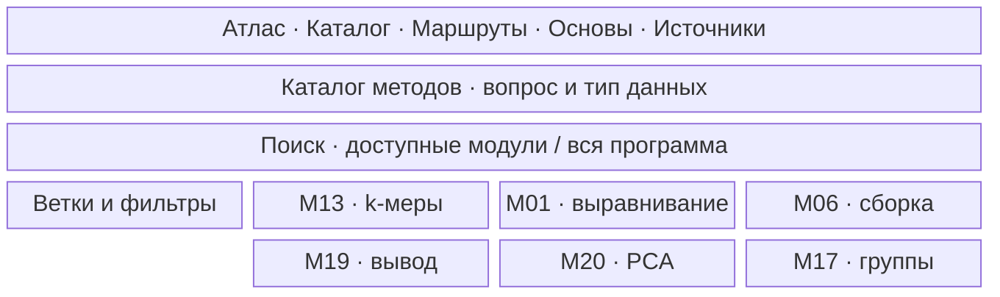
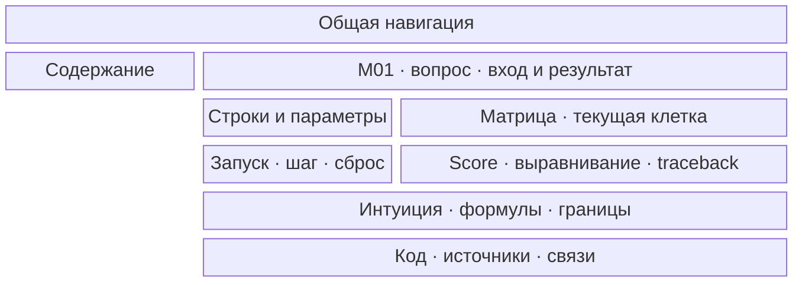

# Интерактивный атлас биоинформатики: итоговая программа и план реализации — v2

Дата синтеза: **27 октября 2026, Москва**. Итог относится к пяти изученным источникам и их сохранённым отчётам; это редакторский и проектный документ. Программирование, создание репозитория и публикация сайта на этом этапе не выполнялись.

**Редакция v2, 27 октября 2026:** уточнены методы K08, визуальная спецификация и расширение через метаданные. Масштаб/ID/MVP сохранены; новый проект приложения не создавался.

## 1. Принятое решение

**Утверждены 35 самостоятельных модулей: 17 обязательного ядра, 13 углублений и 5 модулей явно смежной ветки Neuroevolution / Artificial Life. Первый выпуск — 6 модулей.** Ещё 4 темы остаются кандидатами, 3 прежних ID включены внутрь утверждённых модулей, 1 ID становится методологической справкой. Все 43 исходных ID получают решение; новых M/K-ID нет.

Ядро означает обязательные страницы программы сайта. Это не требование пройти все 17 страниц перед любым практическим вопросом. Очерёдность разработки задаётся отдельно: углубление может выйти раньше некоторого ядра, если оно завершает связный маршрут; в принятом первом выпуске все шесть страниц относятся к ядру.

**Концепция:** посетитель начинает с биологического вопроса или понятного набора данных, меняет условия задачи, видит вычислительные состояния и объясняет полученный вывод вместе с его границами. ДНК, чтения, матрицы измерений и спектры остаются основными предметами сайта. Общая оптимизация обслуживает эти задачи и самостоятельные учебные эксперименты; нейроэволюция и Artificial Life обозначены как соседняя область, со своими входами и результатами.

Каждая страница следует одной схеме: вопрос → вход/выход → интуитивный пример → исполняемый механизм → точная модель/формулы → контрпример → небольшой код и инструмент → источники и ограничения. У вариантов общего метода есть внутренние разделы, а не автоматически собственные страницы. Внешняя программа сопровождается объяснением, какой этап анализа она реализует.

### Использованные материалы и границы проверки

Доступны и использованы: `01_pevsner_selection.md`, `02_compeau_v1_update.md`, `03_compeau_v2_update.md`, `04_akalin_update.md`, `05_neuroevolution_update.md`. Последний отчёт — основной вход; ранние документы проверены в части состава, границ, исходных примеров, глубины и нерешённых вопросов. Исходные файлы сохранены без изменений. Полное повторное чтение пяти книг не выполнялось.

**P** — Pevsner; **V1/V2** — Compeau/Pevzner; **CGR** — Akalin; **NEU** — Neuroevolution. Эти метки у методов сохраняют происхождение. **Внешнее уточнение** — материал сверх книги; **собственный учебный пример** — конструкция редактора. Статус «проект» относится ко всем будущим интерактивам этого плана. Ранее исполненные численные примеры сохраняют статус предыдущего этапа; новые проверки этапа 6 перечислены отдельно.

Дополнительно проверены конкретные вопросы: входная матрица CGR для первого выпуска и официальная совместимость предполагаемой статической архитектуры. Это не новый сплошной проход источников. Ограничения предыдущих этапов не исчезают: R-workflow не воспроизведены, часть внешних NEU-медиа просмотрена выборочно, полноценные современные callers/структурные модели/белковый inference не обеспечены одними учебниками.

### Как выполнен отбор

К каждой теме применены семь оснований: самостоятельность вопроса; фундаментальность; практика; объяснимость механизма; интерактив; опора источников; соответствие замыслу. Решение не получено суммой условных баллов: сильная визуальная привлекательность не компенсирует отсутствие понятной задачи или источников. В таблице решений дано определяющее основание и ограничение каждого ID.

Ключевые редакторские изменения: **K02→M08**, **K05→M28**, **K07→M26**; **K08** становится общей справкой и набором кейсов; **M33** переводится из рабочего основного набора в кандидаты. Все существенные методы объединённых тем сохранены ниже. М 33 не отождествляется с M27: отложена отдельная задача, а не признано тождество алгоритмов.

## 2. Утверждённый каталог

Роли находятся в отдельной таблице следующего раздела. Модульные ID остаются стабильными; исторические ID включённых тем доступны как якоря и поисковые алиасы. «Оптимальное» означает оптимальность в указанной учебной модели, а не достоверную реконструкцию биологического процесса.


| Модуль | Суть | Методы | Интересная особенность |
| ------ | ---- | ------ | ---------------------- |
| **M01. Попарное выравнивание** — Pairwise alignment | Две последовательности и система оценок → оптимальное сопоставление целых строк, участков или концов при заданных границах. | **P/V1:** Needleman–Wunsch, Smith–Waterman, PAM; **P:** BLOSUM. **V1:** ДП на DAG, LCS, edit distance, fitting/overlap, traceback и ничьи; аффинные штрафы, три состояния, middle edge и линейная память. | Переключаем local/fitting при неизменных строках; видим матрицу и traceback. Local может отбросить часть короткой строки, fitting должен сопоставить её целиком. |
| **M02. BLAST и значимость сходства** — Similarity search | Последовательность-запрос и база → похожие участки, score и ожидаемое число случайных совпадений такой силы. | **P:** seed-and-extend, маскирование, эвристическое отсечение, raw/bit score, E-value. **V2:** score-окрестности слов по матрице замен. | Увеличиваем базу при фиксированном выравнивании и статистической модели: score прежний, E-value растёт. Сила сопоставления и неожиданность находки — разные величины. |
| **M03. Множественное выравнивание** — MSA | Предполагаемо родственные последовательности → общая таблица соответствующих позиций для анализа семейства. | **P:** progressive alignment, профили, guide tree, итерации, consistency. **V1:** многомерное ДП, 3D, LCS, sum-of-pairs, энтропия. **V2:** профильное выравнивание через M04. | Три попарных оптимума книжного примера требуют порядка блоков C→T→G→C. Показываем противоречие: отдельные оптимальные сопоставления нельзя одновременно разместить в одном MSA. |
| **M04. Профили и скрытые состояния** — Profiles/HMM | Последовательность и модель → score профиля, вероятность наблюдений, скрытый путь либо вероятности состояний; отдельно — обучение параметров. | **P:** PSSM, PSI-BLAST, profile HMM. **V1:** фон, псевдосчётчики, энтропия. **V2:** Viterbi, Forward, forward-backward, match/insert/delete, оценивание по пути, Viterbi learning, Baum–Welch. **CGR:** PPM→PWM log-odds, information-content logo, порог сканирования. | В сохранённом примере V2 наиболее вероятное состояние каждой позиции — A, но A→A запрещён. Рядом показываем маргинальные вероятности и допустимый Viterbi-путь. |
| **M05. Эволюционные деревья** — Phylogenetic inference | Расстояния либо выравнивание и модель изменений → предполагаемое дерево, ветви и состояния предков. | **P:** поправки расстояний, ML, bootstrap, укоренение; **P/V2:** neighbor joining. **V2:** четыре точки, limb length, AdditivePhylogeny, UPGMA/ультраметричность, discrepancy, Sankoff/Small Parsimony, Large Parsimony и NNI. | В аддитивном примере ближайшая пара листьев не является «вишней». Видим первое объединение UPGMA и поправку NJ; точность исходной матрицы сама по себе не обеспечивает пригодность молекулярных часов. |
| **M06. Сборка генома** — Genome assembly | Чтения без референса → контиги и возможные связи; точный учебный вход — полная k-мерная композиция с кратностями. | **P:** OLC, покрытие, N50. **V1:** overlap/Hamiltonian и de Bruijn/Eulerian graphs; баланс/связность, парные ограничения, неветвящиеся пути/циклы, ошибки, пузыри и кратности. | Линейные строки AAGAA и AGAAA имеют одинаковые кратности 2-меров. Обе дают один контиг длины 5 и одинаковый N50. Выбираем обход и видим, почему точный обход и высокий N50 не удостоверяют исходную строку. Собственный контроль проверен на этапе 6. |
| **M07. Картирование и QC** — Read mapping/QC | Чтения с качествами и референс → отфильтрованные данные, адреса, выравнивания и неопределённость размещения. | **P:** hash/BWT, seed-and-extend, пары, Phred/MAPQ. **V2:** d+1 затравок для d замен, проверка кандидатов, backward search; индекс — M18. **CGR:** Q=−10 log₁₀p, QC по циклам/составу/дубликатам/адаптерам, trimming/filtering, потоковая обработка, практический mapping. | Меняем тип эксперимента при одинаковом QC-графике: C→T-сдвиг ожидаем для бисульфитных данных, а многочисленные одинаковые RNA-чтения могут отражать высокую экспрессию. Универсальный порог способен удалить сигнал. |
| **M08. Варианты генома и их свидетельства** — Variant evidence | Чтения/покрытие, референс и модель ошибок → кандидаты SNV/инделов и крупных изменений; в малой модели — вероятности генотипов. | **P:** genotype likelihoods, глубина/баланс аллелей, неоднозначность инделов и фильтры; SV-свидетельства: discordant pairs, split reads, depth, local assembly. Сигналы сравниваются, универсальный современный caller не заявляется. | Добавляем систематически ошибочные чтения: уверенность неверной модели растёт с глубиной. Затем инвертируем участок без смены числа копий: depth сохраняется, ориентации пар меняются. Видны разные источники свидетельств. |
| **M09. Дифференциальная экспрессия** — Differential expression | Счётчики по генам, независимые образцы и дизайн → изменения экспрессии, их неопределённость и скорректированные проверки. | **P:** микрочипы/линейные модели, биологическая вариабельность. **P/CGR:** NB и FDR. **CGR:** назначение чтений, CPM/RPKM/TPM, median-of-ratios; NB-GLM, shrinkage дисперсий, Wald/contrasts, фильтрация, MA/PCA/rlog; batch-ковариаты и RUVg/RUVs. | В проверенном примере повышаем один ген с 100 до 1000 чтений, остальные оставляем по 100. Их CPM падает в 3,25 раза, хотя исходные значения прежние; медианные отношения сохраняют их уровень. Видим знаменатель и size factors. |
| **M10. Функциональная интерпретация** — Functional enrichment | Список/ранжирование генов, аннотации и фон → категории с избытком попаданий по определённой нулевой модели. | **P:** GO, ORA, гипергеометрический/Fisher, running-sum GSEA, множественные проверки. **CGR:** практические ORA/g:Profiler и GAGE, преобразование ID и ортологов в упражнениях. GAGE и GSEA — разные процедуры. | Не меняя список, переключаем фон «весь геном / реально измеренные гены». Меняются ожидаемые попадания и значимость; фон является частью вопроса, а не настройкой оформления. |
| **M11. Сравнительная геномика и синтения** — Comparative genomics | Аннотированные геномы → семейства/блоки и гипотезы о дупликациях, потерях, перестройках. | **P:** orthology/paralogy, семейства, внешняя группа. **V1:** общие k-меры и reverse complement, dot plot, граф якорей, компоненты и пороги. **V2:** дрожжевой кейс. | Удаляем многие копии после удвоения генома: два блока всё ещё соответствуют одному блоку внешней группы. Синтения сохраняет свидетельство, которое плохо видно по числу дубликатов. |
| **M12. Генетические ассоциации** — Genetic association | Генотипы, признаки и описание выборки → связанные локусы, размер связи и неопределённость. | **P:** таблицы/OR, сцепление/LOD, LD/tag SNP, структура популяции, множественные проверки. Общая статистика — M19; CGR не добавляет GWAS-workflow. | В симуляции меняем LD вокруг фиксированного причинного варианта: максимум ассоциации перемещается. Самый значимый сосед не становится от этого причиной. |
| **M13. Короткие паттерны и состав** — k-mers/skew | Последовательность, k, окно и допуск замен → частоты, позиции, сгущения и накопленная G−C. | **V1:** перекрывающиеся counts, reverse complement, base-4/массив, сортировка, sliding clumps, Хэмминг/d-окрестности, approximate counts, skew, случайный фон. | Для AAAAA при k=3 считаются три перекрывающихся AAA. Меняем окно и допуск замен; видим каждое учтённое вхождение. Прежний книжный контрпример отсутствующего точного, но частого приблизительного паттерна сохранён ниже. |
| **M14. Поиск неизвестных мотивов** — De novo motif discovery | Набор последовательностей с неизвестными положениями сигнала → кандидаты окон, консенсус и профиль. | **V1:** MotifEnumeration, median string, score/энтропия, greedy с псевдосчётчиками, randomized search, Gibbs/restarts. **CGR:** применение к ChIP-пикам, устранение перекрывающихся входов, rGADEM и сравнение PWM; внутренний solver не разобран. | Объединяем перекрывающиеся пики перед извлечением последовательностей. Один повторно включённый участок перестаёт выглядеть как несколько независимых свидетельств мотива. Сравниваем несколько запусков при одинаковом бюджете. |
| **M15. Восстановление пептида** — De novo peptide sequencing | Спектр/спектральный вектор, масса и алфавит → кандидаты пептида без белковой базы. | **V1:** линейные/циклические спектры-мультимножества, перебор, точный branch-and-bound идеальной задачи, leaderboard-эвристика, свёртка. **V2:** спектральный DAG, проверка полного спектра, vectors/dot product, максимальный путь, log-likelihood ratios. | В сохранённом примере V2 только 8 из 32 путей объясняют нужный спектр. Выбираем путь и видим лишние/недостающие массы его теоретического спектра. |
| **M16. Перестройки геномов** — Genome rearrangements | Два порядка ориентированных однокопийных блоков → расстояние и сценарий в выбранной модели операций. | **V1:** signed permutations, reversals, GreedySorting, breakpoints/нижние границы; breakpoint graph, 2-break/DCJ, точные n−c и сортировка круговых геномов. | Для `(−6,+1,+2,+3,+4,+5)` жадная сортировка требует 10 реверсий, оптимум — 2. Сравниваем сценарии; минимальный всё равно не доказывает реальную историю. |
| **M17. Кластеризация** — Clustering | Матрица признаков и мера сходства → группы, центры или иерархия для исследования структуры данных. | **V2:** k-center/farthest-first, SSE/Lloyd, k-means++ с D²-инициализацией, soft assignments/EM на смеси монет, single/average, corrupted cliques/CAST. **V2/CGR:** Euclidean/Pearson. **CGR:** Manhattan/scaling, complete/Ward, PAM/k-medoids, silhouette/gap с нулевым моделированием/1-SE. **NEU:** k-means для CVT-ячеек MAP-Elites и evolve-and-merge локальных правил; это применения прежнего solver. | В книжном примере silhouette выбирает 4 группы, gap — 6, клинических меток — 5. Меняем критерий и k, видим назначения и оценки: единственный «истинный k» из этих чисел не следует. |
| **M18. Поисковые индексы строк** — String indexing | Текст и многократные запросы → число/позиции вхождений после предварительного построения индекса. | **V2:** trie, suffix trie/tree/array, BWT/inverse/LF, backward search, rank/checkpoints, partial SA, mismatches; Aho–Corasick, colouring, LCP/SA→tree. | Для `banana$ → annb$aa` запрос `ana` сужает интервал до позиций 1 и 3 с нуля. Меняем checkpoints/выборку SA: ответ прежний, память и число дополнительных шагов меняются. |
| **M19. Неопределённость и статистический вывод** — Statistical inference | Измерения независимых образцов и статистический вопрос → размер эффекта, интервал, тест и поправка на семейство проверок. | **CGR:** выборка/распределения Normal, binomial, Poisson/NB; bootstrap/CLT/t-интервалы, permutation/Welch t; Bonferroni/BH/q-value; OLS, коэффициенты/CI, остатки, категории/дизайн. **NEU:** шум rollout-fitness и вариабельность запусков. **Редакторское дополнение:** одинаковый бюджет, независимая повторная оценка после выбора. | Повторяем независимые выборки и строим интервалы: видны покрытие истинного среднего и ширина. Затем размножаем технические измерения одного образца; наивный узкий интервал не означает добавления независимых биологических данных. Оптимизм выбора по шуму сохранён отдельным примером. |
| **M20. Снижение размерности** — Dimension reduction | Матрица «образцы × признаки» → компактные координаты, нагрузки и, для факторизаций, приближение исходной матрицы. | **CGR:** центрирование/scaling, PCA через covariance/eigen/SVD, scores/loadings и reconstruction; ICA, NMF; classical/nonmetric MDS; t-SNE, соседские вероятности, KL/perplexity и повторные запуски. **NEU:** PCA/autoencoder в AURORA; VAE и latent dynamics в World Models. UMAP — лишь упоминание/рисунок. | В проверенном примере PC1 сохраняет 99,01% вариации, но удаляет координату, полностью различающую два класса. Меняем масштаб признака и число компонент; видим проекцию, остаток и потерянную информацию. |
| **M21. Прогнозирование и проверка моделей** — Prediction/validation | Признаки, известные ответы и схема разделения данных → модель и оценка работы на новых образцах. | **CGR:** preprocessing/imputation, stratified split/CV/OOB, kNN, деревья/RF, logistic и ridge/lasso/elastic net; importance, ROC/AUC, imbalance/SMOTE/weights; boosting/SVM/NN обзорно с кодом, regression. **Внешн.:** обучение preprocessing внутри folds. **NEU:** FNN/backprop, RNN/LSTM/CNN/attention; ансамбли. Подбор признаков/параметров — внешняя петля с независимой итоговой оценкой после поиска. | Книжное применение — прогноз возраста по CpG-метилированию. Переключаем возрастные диапазоны и смотрим OOB-остатки: хорошая общая оценка способна скрыть систематическую ошибку для старших возрастов. Пока проект воспроизведения сохранённого расчёта. |
| **M22. Геномные интервалы и сигналы** — Genome arithmetic | Интервалы/чтения/покрытие с версией генома и координатами → пересечения, counts, ближайшие объекты и региональные профили. | **CGR:** GRanges/IRanges, many-to-many overlaps, count/nearest/distance, объединение интервалов, coverage; run-length encoding, Views/bigWig-запросы; согласованное подмножество assays/rowRanges/colData, strand-aware TSS-профили. | Растягиваем постоянные участки покрытия: RLE хранит значение и длину серии вместо каждой позиции. Видим сжатую запись и точное восстановление; на чередующемся сигнале выигрыш исчезает. |
| **M23. ChIP-seq: сигнал над фоном** — Enrichment/peak calling | Картированные ChIP/Input и метаданные → кандидаты обогащённых областей, QC и аннотации. | **CGR:** окна/counts, контроль и assay-specific normalization, shift/Jaccard QC; binomial mixture/background в normR, проверки/q-values, narrow/broad bins, merge, reads-in-peaks, PWM-QC. Оценивание смеси показано готовой функцией. | Сдвигаем минус-концы относительно плюс-концов и видим Jaccard-кривую. В проверенной идеальной модели максимум восстанавливает заданный сдвиг 120 bp; артефакты и смесь длин нарушают простую картину. |
| **M24. Метилирование: доли, различия, сегменты** — DNA methylation | C/T-счётчики, покрытие, образцы и координаты → доли, DMC/DMR либо сегментация одного метилома. | **CGR:** conversion/QC/coverage/SNP filters; Fisher с ограничениями pooling; binomial-logistic/overdispersion, beta-binomial/DSS; региональные counts; methSeg change-points→mixture/BIC, аннотация. Внутренний solver сегментации не выведен. | Меняем покрытие двух CpG: 9/10 и 10/100. Среднее долей — 50%, доля объединённых счётчиков — 17,27%. Показываем обе операции: они оценивают разные региональные величины. Это один образец, не объединение реплик. |
| **M25. Совместная структура multi-omics** — Multi-omics integration | Согласованные по образцам expression/mutation/CNV-матрицы → общие факторы, нагрузки и исследовательские группы. | **CGR:** block scaling/MFA, joint NMF, разделение положительных/отрицательных каналов; shared latent model iCluster, lasso/EM-outline; iCluster+ с разными распределениями, MCMC обзорно; кластеризация и обогащение нагрузок. | В проверке умножаем столбец W на 10 и делим строку H на 10: WH не меняется, а argmax-кластер меняется. Показываем факторы и реконструкцию: для свободно масштабируемого NMF нужна согласованная нормировка перед таким присвоением меток. |
| **M26. Эволюционный поиск** — Evolutionary search | Представление кандидата, ограничения и вычислимая оценка fitness → найденные решения и история поиска. Учимся искать без производной целевой функции. | **NEU:** GA: отбор, crossover, mutation, replacement; (μ,λ)/(μ+λ)-ES, Gaussian search; CMA-ES: среднее, ковариация и масштаб; OpenAI ES: оценка градиента ожидаемого сглаженного fitness, rank shaping. GP, DE, PSO, ACO, EDA — обзорные варианты внутри темы. Генеративные операторы: GP/LLM, ELM/LMX/EvoLLM, prompt evolution, AlphaEvolve как комбинация вариации, проверки и архива; подробные различия и режим replay — во внутренних разделах. | Поворачиваем вытянутую долину и меняем шаг мутации; видим популяцию, эллипс поиска и лучший результат. Серии при равном бюджете показывают пользу адаптации направлений и разброс. Это проект интерактива; простые GA/ES-сравнения ранее выполнены на этапе 5, полный CMA здесь не запускался. |
| **M27. Эволюция весов и топологии сети** — Neuroevolution/NEAT | Входы и выходы сети, среда либо размеченные примеры → веса и, при структурном поиске, граф работающей сети. | **NEU:** фиксированная топология + GA/ES; NEAT: innovation numbers, matching/disjoint/excess genes, structural mutations, compatibility/speciation и fitness sharing; recurrent controllers. Deep GA и ES fine-tuning LLM — кейсы масштабирования, не универсальные гарантии. rtNEAT/NERO — пример обновления популяции при взаимодействии. | Два родителя вычисляют одну функцию, но узлы записаны в разном порядке. На проверенном примере скрещивание по позиции разрушает результат; показываем гены и выходы до/после согласования. Историческая маркировка решает задачу происхождения генов, а не гарантирует хорошего потомка. |
| **M28. Компактные кодировки сложных решений** — Indirect encodings | Небольшой генотип и правило развёртывания → изображение, сеть или форма с большим числом элементов. | **NEU:** прямые/косвенные кодировки; L-systems/cellular encoding; CPPN с разными активациями; HyperNEAT: запрос пары координат, substrate/LEO; ES-HyperNEAT: quadtree и детализация по вариации; статические/динамические hypernetworks; DCT и learned generative decoder/LVE. Human/implicit selection, Picbreeder и user fatigue; человеческий выбор — режим оценки. | Меняем одну функцию CPPN и разрешение координатной сетки: одна и та же программа создаёт повторения и симметрию на разных масштабах. Затем ломаем регулярность цели: компактное представление помогает не всем задачам. Симметрия выбранной функции проверена; эволюция такого рисунка — **проект**. |
| **M29. Поиск разнообразных хороших решений** — Novelty search/Quality Diversity | Кандидаты, описание их поведения и, для QD, качество → архив разных поведений с лучшими найденными представителями. | **NEU:** behavioral descriptors и kNN-novelty; population/archive; NSLC — локальная конкуренция; MAP-Elites — ячейка по descriptor, замена по quality; coverage/QD-score; CVT-MAP-Elites, AURORA; CMA-ME и другие расширения — обзорно. | Меняем descriptor «конечная точка» на «траектория»: одинаково заканчивающие маршруты перестают быть одинаковыми. Видим соседей, novelty и заполнение архива. Найденная новизна зависит от представления; это не вероятность успеха и не автоматическое открытие биологического разнообразия. **Проект**. |
| **M30. Компромиссы между целями** — Multiobjective/Pareto optimization | Несколько целей и допустимые решения → приближение множества недоминируемых компромиссов, из которого выбирают по предпочтениям. | **NEU:** dominance, Pareto fronts, weighted sums и масштабы; NSGA-II: sorting, parent–offspring union, crowding distance и усечение; NSGA-III — обзор. Примеры: accuracy/размер сети, качество/стоимость связей. | Двигаем вес двух минимизируемых целей для точек A=(0,2), B=(1.2,1.2), C=(2,0). B недоминируема, но ни одна положительная взвешенная сумма её не выберет. Контрпример **проверен**; показывает, зачем искать фронт, а не один scalar score. |
| **M31. Коэволюция частей и соперников** — Coevolution | Компоненты, команды или противники и правила взаимодействия → совместимые комбинации и меняющиеся стратегии. | **NEU:** cooperative coevolution, SANE/ESP/CoSyNE, blueprints, командный fitness и credit assignment; heterogeneous/homogeneous teams, stigmergy; competitive coevolution, opponent archive, cross-play. DIP защищает инновации возрастом компонента; CoDeepNEAT — пример коэволюции компонентов и схем их сборки. | В «камень–ножницы–бумага» каждый новый чемпион побеждает предыдущего, но цикл не означает общего прогресса. Матрица выплат **проверена**. В проекте переключаем состав соперников и видим cross-play против сохранённого архива, а не только текущий win rate. |
| **M32. Глобальная форма из локальных правил** — Neural cellular automata/development | Начальное состояние клеток/графа и общее локальное правило → развивающийся узор, форма либо сеть. | **NEU:** CA/NCA, local perception, shared neural update, асинхронность; эволюция правила по конечному поведению; HyperNCA и graph NDP; QD для генераторов; отдельное обучение устойчивости градиентным методом. Реакция–диффузия/GRN — модельные предпосылки. | Повреждаем выросший узор и продолжаем те же локальные обновления. Сравниваем правила, обученные только росту и также восстановлению: рост из семени сам по себе не обеспечивает регенерации. Показываем состояния клеток и локальное поле; предобученные правила — расчёт вывода, история обучения — предрасчёт. **Проект**. |
| **M34. Адаптация во время жизни агента** — Evolved plasticity/RL hybrids | Поток наблюдений, иногда награды, и унаследованный механизм адаптации → меняющиеся действия, память и/или веса во время работы. | **NEU:** Baldwin/Lamarck; Q-learning, REINFORCE и ERL: replay buffer + обучаемый RL-actor, возвращаемый в популяцию; NEAT+Q, MAML-Baldwin/ES-MAML; Hebbian ABCD rules, neuromodulation, adaptive HyperNEAT; evolve-and-merge, recurrent state и evolvable NTM. Примеры поведения/советы и KBANN; носитель знания отделён от fitness. | Переставляем награды в T-maze. Одновременно видны действия, состояния памяти, веса и сигнал модуляции: агент может менять поведение без изменения генотипа. Отключаем пластичность и сравниваем повторные эпизоды. Не приписываем фиксированной рекуррентной памяти изменение весов. **Проект**. |
| **M35. Поиск через модель среды** — Surrogate-assisted optimization/World Models | Дорогие наблюдения или симулятор, параметры решения и модель отклика → кандидаты, проверяемые затем исходной системой. | **NEU:** predictor–prescriptor/ESP, обновление surrogate по новым оценкам; surrogate NAS; VAE-vision + predictive MDN-RNN + эволюционируемый controller; rollouts в learned world model и temperature. GP/RIO — кейс оценки остаточной неопределённости, не гарантия переноса. | В книге агент находит лазейку в слишком детерминированном «сне». В своём **проверенном** примере модель почти точна на обучающем диапазоне, но её оптимум вне него плох в исходной функции. Меняем область поиска/температуру; показываем predicted и проверенный результат раздельно. |
| **K04. Пептидная идентификация и белковые свидетельства** — Peptide identification/protein evidence | Спектры и база белков → PSM, оценки случайных совпадений и совместимые белки/группы. | **P:** peptide–protein graph, общие пептиды/неразличимость. **V2:** database score/PSMSEARCH, учебный decoy-FDR, spectral dictionaries/ДП масса–score, случайные попадания, модификации/spectral alignment. | Кейс V2 с загрязнением: сильный PSM не удостоверяет происхождение материала. Добавляем известный загрязнитель и видим совпадение, decoy-оценку и неопределённость источника. |

## 3. Решения по всем исходным ID

| Исходный ID | Итоговое решение | Основное место | Основание |
| --- | --- | --- | --- |
| M01 | Ядро | Последовательности | Точная оптимизация с видимыми состояниями; фундамент для поиска, профилей и картирования; сильная опора P/V1. |
| M02 | Ядро | Последовательности | Практический поиск по базе и отдельный вопрос о значимости совпадения; эвристика и статистика не заменяются уроком ДП. |
| M03 | Ядро | Последовательности | Общее соответствие позиций нескольких строк; прогрессивная эвристика и согласованность имеют собственные ограничения. |
| M04 | Ядро | Последовательности | Вероятность наблюдений, скрытый путь и обучение модели — самостоятельная основа многих анализов; V2 восполняет глубину P. |
| M05 | Ядро | Сравнение и разнообразие геномов | Переход от сходства к исторической гипотезе; модели и проверяемые ограничения дерева требуют отдельного урока. |
| M06 | Ядро | Геномы и чтения | Самостоятельное восстановление без референса; графовый механизм, неоднозначность и метрики сборки. |
| M07 | Ядро | Геномы и чтения | Реальный вход многих workflow; размещение и QC отличаются от восстановления генома; современный большой mapping — предрасчёт. |
| M08 | Углубление | Геномы и чтения; включает K02 | Сильная задача оценки геномных свидетельств; объединяем масштабы вариантов, сохраняя разные сигналы. Полный современный caller источниками не обеспечен. |
| M09 | Ядро | Измерения и регуляция | Путь от counts и дизайна к проверяемому эффекту; CGR даёт нормализацию, вариабельность и диагностику. |
| M10 | Ядро | Измерения и регуляция | Отдельный вопрос о фоне и функциональном избытке; применим к спискам из разных assays, поэтому не поглощается M09. |
| M11 | Углубление | Сравнение и разнообразие геномов | Поиск соответствующих блоков и событий дупликации отличается от минимального сценария перестроек; хорошие межкнижные кейсы. |
| M12 | Углубление | Сравнение и разнообразие геномов | Ассоциация, LD и структура выборки дают собственные ошибки интерпретации; современный практический GWAS требует добавочных источников. |
| M13 | Ядро | Последовательности | Самый доступный механизм работы со строками и фундамент M06/M14/M18; частота и приближённое совпадение ясно вычислимы. |
| M14 | Ядро | Последовательности | Обнаружение неизвестного сигнала отличается от применения готового профиля; точные постановки и стохастические эвристики сопоставимы. |
| M15 | Углубление | Спектры и белки | Восстановление последовательности без базы — самостоятельная обратная задача; графы и отсечение раскрыты V1/V2. |
| M16 | Углубление | Сравнение и разнообразие геномов | Конкретная модель операций и вычисляемое расстояние; не объединяется с широким сравнением геномов M11. |
| M17 | Ядро | Данные и вывод | Самостоятельная постановка группировки, выбор расстояния и критерия; сильные механизмы V2 и практические примеры CGR. |
| M18 | Углубление | Последовательности | Предварительная обработка текста ради многих запросов — свой вычислительный вопрос; отделяется от BLAST и размещения чтений. |
| M19 | Ядро | Данные и вывод | Единица независимости, эффект и неопределённость нужны всем аналитическим веткам; обязательны исправления вводных формулировок CGR. |
| M20 | Ядро | Данные и вывод | Геометрия представления, сохранение информации и нагрузок; выразительный интерактив и прямые применения к omics. |
| M21 | Ядро | Данные и вывод | Предсказание для новых образцов и его независимая оценка; ядро включает нейросетевую основу, но не обещает полный AutoML/NAS. |
| M22 | Ядро | Геномы и чтения | Координаты, many-to-many overlaps и региональные сигналы — самостоятельные операции с критичными ошибками границ. |
| M23 | Углубление | Измерения и регуляция | Обогащение над локальным фоном и экспериментальный контроль; QC/мотивы связывают несколько основных модулей. |
| M24 | Углубление | Измерения и регуляция | Доля при разном покрытии, межобразцовая вариабельность и сегменты — отдельная модель измерений. |
| M25 | Углубление | Измерения и регуляция | Согласование нескольких матриц и неидентифицируемость факторов; источников хватает для ограниченной учебной постановки, не полного multi-omics workflow. |
| M26 | Углубление | Общая оптимизация; включает K07 | Самостоятельный общий поиск по вычислимой цели; генеративная вариация — расширяемый оператор той же петли. Био-приложения подписываются отдельно. |
| M27 | Смежная ветка | Neuroevolution / Artificial Life | Прямой поиск работающей сети, её весов и топологии; сильная механика NEAT, но не обязательный материал для анализа геномов. |
| M28 | Смежная ветка | Neuroevolution / Artificial Life; включает K05 | Вопрос о развёртывании компактного описания; человеческий отбор добавляет режим исследования CPPN, не новую обязательную страницу. |
| M29 | Углубление | Общая оптимизация | Результат — репертуар по descriptors, а не один максимум и не фронт целей; это самостоятельная организация поиска. |
| M30 | Углубление | Общая оптимизация | Недоминирование и сохранение компромиссов отличаются от поведенческой новизны; есть проверенный контрпример и научные применения. |
| M31 | Смежная ветка | Neuroevolution / Artificial Life | Зависимость оценки от партнёров/противников и credit assignment; алгоритмически содержательно, но не общий курс молекулярной эволюции. |
| M32 | Смежная ветка | Neuroevolution / Artificial Life | Локальная динамика порождает форму; механизм, визуал и контроль повреждений сильны; биологическая достоверность не подразумевается. |
| M33 | Кандидат | Отложенная тема AutoML/NAS | Был основным рабочего набора. Самостоятельный вопрос сохранён, но полный поиск архитектур/обучающих систем расширяет сайт до общего AI и дорогого benchmarking. В M21 остаётся базовая схема внешнего подбора; детали NAS отложены, а не слиты с NEAT. |
| M34 | Смежная ветка | Neuroevolution / Artificial Life | Изменение агента в эпизоде имеет свою временную ось и носитель памяти; полезно для понимания пластичности, не обязательная биоаналитика. |
| M35 | Углубление | Общая оптимизация | Выбор действий через приближённую модель отличается от оценки точности предиктора; эксплуатация ошибки модели даёт сильный эксперимент. |
| K01 | Кандидат | РНК и структуры, вне утверждённого каталога | Вопрос самостоятелен, но для полноценного алгоритмического урока нужны специальные источники по рекурсиям MFE/partition и моделям энергии. |
| K02 | Внутри другого | M08, раздел масштаба и свидетельств | Отдельная страница не нужна: discordant pairs/split reads/depth/local assembly сопоставляются со свидетельствами малых вариантов; универсальный SV-caller не заявляется. |
| K03 | Кандидат | Белковые структуры, вне утверждённого каталога | RMSD/coverage и шаблонное моделирование полезны, но одной основы P недостаточно для цельного современного урока предсказания структуры. |
| K04 | Ядро | Спектры и белки | Идентификация по базе и неоднозначность белковых свидетельств практически самостоятельны; исторический K-ID сохраняется. |
| K05 | Внутри другого | M28; ссылки на M27/M34 | Human selection/Picbreeder — режим M28; rtNEAT/NERO остаётся примером M27, советы/KBANN — M34. Нагрузку человека и историю выбора сохраняем. |
| K06 | Кандидат | Open-ended evolution, вне утверждённого каталога | Новые задачи и перенос — самостоятельный вопрос, не частный случай фиксированного турнира M31; полнота демо и валидная оценка прогресса ещё требуют работы. |
| K07 | Внутри другого | M26; ссылки на M29/M33 | GP/LLM предлагают вариации, внешний evaluator определяет принятие. ELM/LMX/EvoLLM, prompt evolution и AlphaEvolve остаются углублением операторов/архива, без отдельной GenAI-ветки. |
| K08 | Справочный материал | F-БИО и кейсы M26/M27/M28/M30/M31/M32/M34 | Симуляция, подгонка к данным и историческое объяснение требуют общей методологической справки; отдельная страница не нужна для каталога вычислительных задач. |


### Что именно сохраняется при включении тем внутрь

| Исторический ID | Основное место | Обязательное сохранение материала |
| --- | --- | --- |
| K02 | M08, внутренний якорь `structural-evidence` | Discordant pairs, split reads, depth, local assembly; инверсия без изменения depth; сравнение класса сигнала и класса варианта. Учебная модель генотипа малых вариантов не объявляется моделью всех SV. |
| K05 | M28, якорь `human-selection`; ссылки M27/M34 | Picbreeder/CPPN, история выбора, implicit fitness и user fatigue — M28; rtNEAT/NERO и замещение популяции — M27; task shaping, behavioural examples, advice/KBANN — M34. Самостоятельная страница K05 не публикуется; ID ведёт к основному якорю. |
| K07 | M26, якорь `generative-variation`; ссылки M29 и кандидат M33 | GP, ELM/diff mutation, LMX, EvoLLM, EvoPrompt/Promptbreeder; AlphaEvolve: генерация→исполнение→score→архив/islands. Разделяются предложение варианта и его проверка. Для сайта сначала replay закреплённых примеров, без обязательного LLM API. |
| K08 | Опорная справка F-БИО, якорь `simulation-and-evidence` | Различие естественной эволюции, алгоритма, научной симуляции и подгонки к данным. Wiring-cost/modularity — M30/M28; биофизическая подгонка — M26/M30; кооперация/коммуникация — M31; развитие — M32; пластичность — M34. Lesion/RF/network motifs/CPG — M27; Shapley contribution — M31; объём уточнён в следующей таблице. |

Кандидаты сохраняются в редакторском backlog, без пустых страниц в публичном каталоге. Для **M33** сохранены CoDeepNEAT/CMTR, AmoebaNet/aging, backprop NEAT, supernets/proxies/AutoInit, bilevel evolution, PBT/EPBT, TaylorGLO/PANGAEA, FS-NEAT, AutoML-Zero и model merging; контрпример смены ранга раннего/полного обучения остаётся ссылкой из M21. Для **K06** сохраняются POET/enhanced POET/PATA-EC, OMNI/OMNI-EPIC, перенос и ограничения оценки open-endedness. Для **K01/K03** остаются исходные задачи и полезные примеры; принятие страницы требует отдельного усиления источников.

### Методы K08: уточнённое размещение

Сверены строка K08 отчёта 05 и полный текст **NEU, §14.1 Understanding Neural Structure, печ.388–391 / HTML-блоки 408–411**. В книге это описания исследовательских кейсов и идей анализа с разной глубиной, без готового общего программного workflow. Якоря ниже относятся к HTML-макету, а не к страницам PDF. K08 остаётся справочным материалом; новые модули и обязательства MVP не добавляются.

| Метод | Образовательный смысл | Место на сайте | Решение и обоснование |
| --- | --- | --- | --- |
| **Абляции и lesion-анализ** | Проверять, как изменяется поведение после удаления/замораживания компонента; различать необходимость при данном режиме и достаточность для функции. Отдельный узел может переключать поведение, но это устанавливается вмешательством в модель. | **M27**, подраздел `function-of-parts`; локальные применения M34 — отключение пластичности, M32 — отключение обновления/составляющей правила. Общая граница вывода — F-БИО. | **Включить небольшой подраздел с одним контролируемым экспериментом.** [NEU, печ.388–389](https://neuroevolutionbook.com/ne_book.html#pf198): lesion-анализ назван и связан с ролью command neurons в навигации/собирательстве; подробный протокол не приведён. Для сайта: baseline и изменённая модель на одинаковых входах/средах, явный способ выключения, серия эпизодов при шуме. Полный обзор нейрофизиологических lesion techniques не входит в программу. |
| **Анализ рецептивных полей — receptive-field analysis** | Связать изменение входного стимула с откликом узла; понять зависимость отклика от контекста и состояния. Изображение весов само по себе не является измеренным рецептивным полем произвольной сети. | **M27**, дополнительный пример `input-response`, рядом с анализом найденной сети; ссылка из нейросетевого раздела M21. | **Оставить один дополнительный пример, не обязательный отдельный интерактив.** [NEU, печ.388](https://neuroevolutionbook.com/ne_book.html#pf198) упоминает применение к evolved controllers, но не выводит метод. Сайт может показывать собственный малый stimulus–response map: остальные входы фиксированы, для рекуррентной сети оговорены reset/история. Не приписывать этот учебный протокол книге и не добавлять полный курс сенсорной нейрофизиологии. |
| **Вклад на основе значений Шепли — Shapley contribution** | Показать, почему вклад элемента зависит от других элементов и почему одиночное выключение может пропустить избыточность. Средний предельный вклад определяется выбранной коалиционной игрой и способом вмешательства. | **M31**, дополнительный пример `coalitional-contribution` в разделе credit assignment; обратная ссылка из M27. | **Сохранить концептуальное углубление и собственный точный пример для 3 элементов.** [NEU, печ.388–389](https://neuroevolutionbook.com/ne_book.html#pf198) кратко объясняет multiple perturbations/Shapley и ссылается на Keinan et al.2006, без формулы и алгоритмического вывода. На сайте достаточно таблицы 8 коалиций и среднего прироста по 6 порядкам включения. Полный scalable MSA и feature-SHAP не входят в утверждённый объём. Биологический причинный вывод из условной игры не следует. |
| **Сетевые мотивы — network motifs** | Различать небольшой рисунок связей, статистически избыточный мотив относительно выбранного случайного фона и фактическую функцию цепи. Структура не определяет поведение без весов, знаков, динамики и входа. | **M27**, короткая структурная вставка `network-motifs`; ссылка на модульность/стоимость связей в M30 и справку F-БИО. | **Включить определение и разобранную схему; осознанно исключить самостоятельный поиск/enrichment сетевых мотивов.** [NEU, печ.390–391](https://neuroevolutionbook.com/ne_book.html#pf19a): частота относительно случайных сетей, примеры функций и роль меняющихся целей объяснены качественно; алгоритма перечисления/теста нет. У картинки без заданной нулевой модели не писать «мотив статистически обогащён». Это топология графа, в отличие от последовательностных мотивов M14. |
| **Центральные генераторы паттернов — central pattern generators, CPG** | Увидеть, как фиксированная рекуррентная система порождает ритм; отделить динамику состояний от обучения весов и смены поколений. | **M27**, дополнительный кейс `recurrent-rhythms`; сравнительная ссылка из M34 «ритм без изменения весов». | **Сохранить ограниченный разобранный кейс с предрассчитанной траекторией.** [NEU, печ.390](https://neuroevolutionbook.com/ne_book.html#pf19a) описывает небольшие CTRNN-модели локомоции, осцилляции и мультистабильность; не даёт полного численного протокола. Для первого варианта кейса нужны закреплённые уравнения/параметры из первоисточника и trace, а не произвольно нарисованная синусоида. Полный курс численного анализа ОДУ, новый роботический симулятор и перенос на реальную эволюцию походки не добавляются. |

**CPG ≠ CpG:** CPG — нейронный генератор ритма; CpG — динуклеотид ДНК и контекст метилирования в M24. Это разные понятия с ключами `cpg-neural` и `cpg-dna`. Поиск может находить оба написания без учёта регистра, но выдача сохраняет подписи «нейронная динамика» и «метилирование ДНК», а не объединяет их. Аналогично различаются `network-motif` и `sequence-motif`.

Первоисточник Shapley: **Keinan, Sandbank, Hilgetag, Meilijson, Ruppin (2006), Axiomatic Scalable Neurocontroller Analysis via the Shapley Value**, DOI[10.1162/artl.2006.12.3.333](https://doi.org/10.1162/artl.2006.12.3.333); [библиографическая запись и аннотация](https://pubmed.ncbi.nlm.nih.gov/16859444/). Они проверены; полный PDF в этом проходе недоступен, его алгоритм не объявляется прочитанным/воспроизведённым. Дополнительный учебный пример — собственная игра: v(S)=1, если в коалиции присутствуют одновременно A и B либо присутствует C. Одиночное удаление из полной коалиции даёт loss0 для всех; средние предельные вклады равны 1/6,1/6,2/3. Это арифметическая иллюстрация коалиционного вклада, не результат биологического исследования.


### Решения по спорным границам

| Пара | Решение и причина |
| --- | --- |
| M27 / M33 | Разные задачи. M27 находит исполняемую сеть по её работе; M33 проектирует систему, которую ещё предстоит обучать и оценивать. M27 утверждён в смежной ветке; M33 остаётся кандидатом. |
| M28 / M32 | Сохранить раздельно. M28 объясняет отображение генотип→большой объект; M32 — последовательность локальных обновлений, рост и устойчивость. Одна компактная кодировка может задавать локальное правило, но это не делает выходы и эксперименты одинаковыми. |
| M33 / M34 | Сохранить разные вопросы. Внешнее проектирование алгоритма обучения и изменение памяти/весов во время эпизода имеют разные данные и временные оси. В M34 локальная адаптация не объявляется NAS. |
| M29 / M30 | Сохранить раздельно. M29 распределяет решения по описанию поведения и quality; M30 сравнивает векторы целей по доминированию. Descriptor не обязан быть целью. |
| M35 / M21 | Сохранить раздельно. M21 измеряет переносимость прогноза на новые данные; M35 использует модель для выбора следующего решения и затем проверяет его исходной системой. Малый prediction error не обеспечивает хороший найденный optimum. |
| K06 / M31 | Не объединять. M31 меняет взаимодействующие стратегии в заданном классе задач; K06 создаёт и отбирает сами задачи. Кандидат K06 имеет отдельный будущий критерий готовности. |
| K07 / M26 | Включить как семейство операторов. Генератор меняет распределение предлагаемых кандидатов внутри общей петли вариации/оценки. Архив и evaluator объясняются общими компонентами, а детали крупных моделей остаются углублением. |
| M11 / M16 | Сохранить раздельно. Сначала нужно установить соответствующие блоки и биологическую интерпретацию; затем можно решать точную задачу перестановок в явно ограниченной модели. |

### Полезные примеры, не помещённые в главный столбец

- **M06, V1:** эйлеров обход парного графа способен нарушить ограничение расстояния между парами. Включить рядом с неоднозначностью повторов и N50.
- **M13, V1:** максимум приблизительных совпадений может принадлежать слову без точных вхождений. Точный/приближённый режимы имеют разные критерии.
- **M19/M21, собственная проверка этапа 5:** лучший из 100 кандидатов с одинаковым истинным fitness и шумом N(0,1) имеет завышенную выбранную оценку; независимая переоценка снимает этот эффект.
- **M17, CGR:** silhouette4/gap6/пять меток — сохранённый книжный пример, не гарантированный результат новой версии пакета или любого seed.
- **M21, CGR:** прогноз возраста по метилированию; проверять ошибку отдельно по диапазонам возраста.
- **M27/M28, NEU плюс проверенный первичный проект:** WANN с одним общим случайным весом отличается от сети с независимыми случайными весами. Число 94.2% относится к trained individual weights; условия нельзя смешивать.
- **M30/K08, NEU:** цена длинных связей меняет модульность найденных сетей в заданной модели; механизм изучается через ablation и несколько запусков.
- **M35, NEU:** virtual и actual score контроллера в World Models различаются; temperature влияет на возможности эксплуатации модели, без универсальной монотонной гарантии.
- **K04↔M07, P и редакторская связь:** общие пептиды и неоднозначно размещённые чтения дают граф многих соответствий. Вероятностные модели этих измерений объясняются отдельно.

Подтверждённые биологические мосты из отчёта 05: fitting электрофизиологической модели [Druckmann et al.2007](https://www.frontiersin.org/journals/neuroscience/articles/10.3389/neuro.01.1.1.001.2007/full), DOI10.3389/neuro.01.1.1.001.2007, для M26/M30; cross-modal MUiR с геномной задачей [Meyerson & Miikkulainen2019](https://proceedings.neurips.cc/paper_files/paper/2019/file/8526e0962a844e4a2f158d831d5fddf7-Paper.pdf), §4.2/Table3, для M21/M28. Они не подтверждают универсальность метода или multi-omics workflow. Поиск репертуара multi-omics-моделей через QD остаётся **исследовательской гипотезой**, без обещания реализации и практической эффективности.

## 4. Структура сайта

Верхняя навигация: **Каталог — Маршруты — Основы — Источники и воспроизводимость**. Внутри каталога восемь веток. Каждая страница существует в одном экземпляре и находится через несколько тегов; не делаем отдельные версии урока «для биолога» и «для программиста».

| Ветка | Модули | Граница и связи |
| --- | --- | --- |
| Последовательности и сигналы | M13, M01, M02, M03, M04, M14, M18 | Сопоставление, распознавание, обнаружение сигнала и индексирование различаются по вопросу. Профили связывают последовательности с регуляцией и семействами. |
| Геномы и чтения | M06, M07, M08, M22 | Восстановить, разместить, оценить отклонение, посчитать региональное свидетельство. Переход к assays проходит через M07/M22. |
| Сравнение и разнообразие геномов | M05, M11, M12, M16 | История, соответствие блоков, статистическая связь и сценарий перестроек — разные выходы. Название не отождествляет ассоциацию с эволюционной реконструкцией. |
| Измерения и регуляция | M09, M10, M23, M24, M25 | Разные модели counts, долей, локального фона и согласованных матриц. Общая статистика — M19; координаты — M22. |
| Спектры и белки | K04, M15 | Совпадение в базе/белковые свидетельства и de novo восстановление последовательности; структура белка пока кандидат K03. |
| Данные и вывод | M19, M20, M17, M21 | Проверка эффекта, представление, группировка, прогноз. Задачи различаются даже при общей входной матрице. |
| Общая оптимизация | M26, M30, M29, M35 | Поиск одного решения, компромиссов, репертуара и решений через модель. Явные учебные применения; перенос на omics требует собственного свидетельства. |
| Neuroevolution / Artificial Life | M27, M28, M31, M32, M34 | Сети, кодировки, взаимодействия, локальное развитие и адаптация. Отдельная маркировка смежной ветки сохраняется и в поиске, и на странице. |

### Визуальная концепция и два экрана

**Направление — светлый научный атлас:** длинный текст читается как современная учебная книга, а вычислительная сцена выглядит как аккуратная рабочая область с наблюдаемыми состояниями. Иерархия строится на типографике, отступах и структуре данных. Основной выразительный элемент — сам механизм: путь в матрице, граф, проекция или серия интервалов. Случайные изображения ДНК и декоративные анимации не используются как замена содержанию.

#### Типографика, цвет и ритм

| Элемент | Спецификация |
| --- | --- |
| Учебный текст | IBM Plex Serif,400/600; desktop18px, line-height1.65, строка до 68ch. На мобильном 17px с тем же интерлиньяжем. Fallback Georgia/serif. |
| Навигация, заголовки, параметры | IBM Plex Sans,400/600; основной UI16px, подписи 14px/1.45. H1:48px/1.12 на широком экране,32px/1.15 на мобильном; H2:28px/1.25; H3:22px/1.3. Размеры задаются в rem с адаптивными пределами. |
| Код, последовательности, числа | IBM Plex Mono,400; код 14px/1.6, ввод последовательностей 18px. В таблицах и score — tabular numerals; символ пропуска и нулевой символ/индекс различимы. Fallback ui-monospace/monospace. |
| Фон/поверхность | `paper #F7F8F5`; карточки/поля `surface #FFFFFF`; код `code-bg #F0F3F5`. |
| Текст | `ink #18232D`; пояснения `muted #52616B`. Цвет muted сохраняет читаемость мелких подписей. |
| Действие/выбор | `accent #006B63`; активная подложка `selected #E4F2EE`; ссылка/альтернативный путь `link #2459A6`. Ссылки в тексте подчёркнуты. |
| Предупреждение/ошибка | `warning #9A4D08` на `warning-bg #FFF3DE`; `error #A33829` на `error-bg #FBEAE7`. Всегда есть текст/значок, а не только цвет. |
| Границы | `divider #D5DDD9` для декоративных разделителей; `control-border #6B7C85` для распознаваемых границ полей. Focus — контур 2px цвета link с отступом 2px. |
| Отступы и формы | Шкала 4/8/12/16/24/32/48/64px; карточки с радиусом 12px, поля 8px; слабая тень только для поднятого меню. Основные блоки разделены пространством, а не множеством рамок. |

Семейство IBM Plex и открытая лицензия подтверждены [официальным репозиторием](https://github.com/IBM/plex). Используются закреплённые локальные WOFF2 с кириллицей/латиницей и только нужными начертаниями, `font-display:swap`. Версии и фактические glyph coverage проверяются при сборке. Математический шрифт поставляется вместе с выбранным renderer; его не подменяем Mono.

В графике значения всегда сопровождаются числами/легендой. Основной traceback — teal плюс сплошная линия и стрелки; альтернативный — blue плюс пунктир. Неверный/недопустимый шаг обозначен подписью и перечёркиванием. Последовательная шкала значений отделена от выделения выбранной клетки; при сравнении запусков диапазоны шкалы согласованы. Цвет вершины или номер кластера не становится свидетельством биологического класса.

Основная кнопка — accent с белой надписью; hover `#00554F`, focus — общий контур. Вторичная кнопка — белая поверхность, ink и control-border; hover меняет границу, а не значение параметра. Selected — подложка selected и accent-контур. Disabled сохраняет читаемую подпись и объяснение недоступности; running показывает текст «Считаем…» и доступную отмену. Invalid связывает сообщение с полем, не оставляет только красную рамку. Для небольшого проекта предпочтительны обычные HTML-поля/radio/select с общей стилизацией.

#### Экран 1 — каталог методов

**Целевое состояние после MVP:** по умолчанию показаны 6 опубликованных модулей; переключатель «Вся программа» раскрывает 35 утверждённых тем. Остальные 29 имеют метку «В программе» и ведут к разделу очереди, без пустой страницы урока. Четыре кандидата находятся только в редакторском backlog. Эти числа описывают проектируемый выпуск; они не означают, что модули уже реализованы.

Для viewport1440px основной контейнер 1280px с полями 80px; шапка 64px. Ниже 48px отступ, H1 «Каталог методов», краткий текст «Выберите данные или вопрос — и исследуйте, как получается ответ». Затем строка поиска 48px высотой: «Название, вопрос, метод или ID».



Схема показывает расположение, не точные высоты. Реальные размеры и поведение:

| Зона | Расположение и содержание | Поведение |
| --- | --- | --- |
| Фильтры | Слева 220px, промежуток 32px до сетки; группы «Ветка», «Данные», «Место в программе» | OR внутри группы, AND между группами и поисковой строкой. Видны выбранные фильтры, число результатов и «Сбросить». |
| Результаты | Справа 1028px;3 колонки примерно 327px, gap24px. Порядок редакторский, а не по числу кликов | При фильтрации не меняется текущий фокус произвольно; результат объявляется одной короткой строкой. Пустая выдача объясняет причину и предлагает сброс. |
| Карточка | Сверху ID и роль; название 22px, затем вопрос/суть, строка «Вход→выход», до 3 видимых названий методов; снизу происхождение P/V1/... | Одна ссылка на всю карточку; теги внутри неё не становятся вложенными кнопками. Короткий текст редактируется автором, автоматическое обрезание смысловой части не применяется. |
| Миниатюра | Небольшая схема своего контрольного примера: окно, DP-путь, граф, интервалы или оси | Допустима статическая SVG, созданная из того же fixture; она не изображает непрерывный расчёт. Не обязательна для добавления модуля. |
| Роль/готовность | «Ядро/Углубление/Смежная ветка» и отдельно «Доступен/В программе» | Редакторская роль не смешивается с публикационной готовностью. У смежной ветки всегда есть текстовая маркировка. |

При ширине 768–1199px фильтры убираются в раскрываемую панель, сетка имеет 2 колонки; при ширине менее 768px —1 колонка с полями 16px. Поиск и число результатов видны до карточек. Состояние фильтров можно сохранить в URL; восстановление не требует сервера. Сначала посетитель узнаёт вопрос карточки, затем метод — так каталог остаётся понятным без знания названий алгоритмов.

#### Экран 2 — M01 «Парное выравнивание»

Публичный заголовок — «Парное выравнивание», English subtitle — Pairwise alignment; «Попарное выравнивание» остаётся поисковым синонимом. ID M01 и состав модуля сохраняются.

Desktop1440px: тот же контейнер 1280px. Слева 192px оглавление, gap32px, справа 1056px основной контент. Обычный текст занимает не более 720px; эксперимент использует всю ширину основного контента. Его параметры занимают 272px, gap24px, рабочая область 760px. Оглавление фиксируется ниже шапки, параметры фиксируются только в пределах своего эксперимента, без перекрытия следующих разделов.



| Порядок | Что видит посетитель | Действие/переход |
| --- | --- | --- |
| 1. Заголовок и вопрос | Хлебные крошки «Каталог / Последовательности», M01/Ядро; «Как задать область сопоставления и восстановить лучший путь?»; одна строка входа/выхода | «Исследовать пример» ведёт к `#experiment`, «Разобраться по шагам» — к `#intuition`. До большой формулы понятна задача. |
| 2. Короткая интуиция | Пример трёх букв с совпадением/пропуском и подписью к score, до 100 слов | Не требуется читать весь урок перед первым действием. |
| 3. Эксперимент | Слева A — целевая строка, B — запрос; стартовый контроль `ACG/ACG`. Режим, система оценок, gap-модель. Справа место для матрицы и результата | Первоначально кнопка «Рассчитать»; до неё результат не выдумывается. После расчёта — score6, выравнивание ACG/ACG и доступный пошаговый просмотр; autoplay не запускается. |
| 4. Пояснение шага | Выбранная клетка, три кандидата перехода с числами, выбранный predecessor; ниже выравнивание и слагаемые score | Выбор клетки связывает матрицу, текущую рекурсию и буквы. При ничьей видны альтернативы; правило выбранного traceback подписано. |
| 5. Теория и варианты | Рекурсия, определения величин, начальные/конечные условия; global/local/fitting/overlap, аффинные состояния и линейная память | Кнопка «Показать в эксперименте» меняет только заявленный режим/пример. Состояние полей сохраняется при чтении текста. |
| 6. Контрпример и границы | «Фланки», «Часть запроса», «Равные оптимумы»; оптимальность по score отделена от биологической интерпретации | В fitting сопоставляется весь B с подстрокой A; overlap по умолчанию означает суффикс A к префиксу B. Направление указано рядом с выбором, а не скрыто в коде. |
| 7. Код, практика, источники | Псевдокод и имеющийся проверенный код отдельными вкладками; источники с разделом/страницами и глубиной | Не выводить пустые вкладки языка. Связанные опубликованные модули открываются; будущие ведут к программе, а не к 404. |

**Параметры и состояния:** простая оценка задаёт match2, mismatch−1 и вклад линейного пропуска−2. Аффинный режим отдельно показывает неотрицательные стоимости открытия/продолжения и вычитаемую величину `open+(length−1)·extend`. Расширенные настройки и белковые PAM/BLOSUM раскрываются по потребности; допустимый алфавит/матрица явно согласованы. Изменённые параметры помечают старый результат «Предыдущий расчёт» до пересчёта. Есть состояния idle/running/ready/error/cancelled; ошибка рядом с полем объясняет исправление. Кнопки управления имеют текстовые имена; кнопка шага до появления trace недоступна с пояснением.

Матрица — SVG/HTML с числовыми клетками, заголовками A/B и индексами. Для малого контроля размер клетки 48px; для больших учебных входов — отдельный scroll viewport с выбранной клеткой и текстовым описанием. Нельзя сжимать 120×120 чисел до нечитаемой картинки. После изменения layout или zoom вычисленный ответ не меняется.

#### Формулы, код, источники и мобильный экран

Формула располагается отдельным блоком на светлой поверхности с номером/якорем, затем расшифровка символов и условий. Не надо помещать всю расшифровку в мелкую подпись. Предполагается KaTeX с HTML+MathML и текстовым объяснением; техническая возможность подтверждена [официальными опциями](https://katex.org/docs/options). Длинная формула имеет собственную прокрутку, окружающий текст остаётся в ширине экрана. Код — светлый блок с подписью языка, копированием и выделением текущих строк; комментарии не становятся малоконтрастными. Источники — компактный список под уроком и локальные ссылки рядом с утверждениями, без отрыва читателя на отдельную большую библиографию ради одного номера страницы.

На 768–1199px оглавление становится раскрываемым списком, основной контент занимает контейнер; параметры 240px и рабочая область делят доступную ширину, пока она позволяет читать. Ниже 768px порядок линейный: вопрос→краткая интуиция→ввод/параметры→управление→матрица→результат→объяснение→теория/код/источники. Параметры не прячутся в боковой drawer на телефоне. «Дополнительные настройки» сворачиваются; последовательности/основной режим остаются видны. У таблицы/матрицы собственная прокрутка, у страницы её нет. Шапка 56px, поля 16px, никаких постоянных панелей, перекрывающих результат или клавиатуру.

#### Доступность и приемка оформления

Цель — WCAG2.2 AA, с собственным размером интерактивных целей не меньше 44×44px. Для обычного текста нужен контраст≥4.5:1, для крупного текста и значимых графических границ≥3:1. Требование 44px — выбранный стандарт продукта; базовый минимум WCAG2.2 AA имеет 24px с исключениями. [Опора W3C](https://www.w3.org/WAI/WCAG22/quickref/).

- Иерархия h1/h2/h3, landmarks, skip-link, видимый focus, правильный DOM-порядок. Sticky-блоки не скрывают сфокусированную ссылку/клетку.
- Карточки/фильтры/поля управляются клавиатурой; матрица имеет один вход с перемещением по клеткам и текстовым описанием. Перетаскивание и zoom имеют кнопочную/клавиатурную альтернативу.
- Цвет дополнен подписями/линиями/формой. Для графа/матрицы доступны текущие числовые данные и описание, а не только canvas.
- `prefers-reduced-motion` убирает анимацию переходов; «Шаг» сохраняет действие. Нет autoplay или вспышек. Старт/окончание вычисления объявляются кратко через live region, не каждый кадр анимации.
- Интерфейс проходит reflow при 320px и увеличении до 400%; двумерная матрица/код могут иметь локальную прокрутку. Проверяются русские длинные названия, формулы и fallback при недоступном шрифте.

Эта композиция сохраняет короткую строку чтения, оставляет формуле достаточно места и связывает конкретное число с визуальным состоянием. Контраст/ритм отделяют объяснение от управления; отсутствие лишних поверхностей даёт сложному материалу визуальную иерархию. Макеты являются спецификацией расположения; реальное браузерное отображение, шрифты и assistive technologies ещё предстоит проверить при реализации.


### Общий фундамент и владельцы понятий

Четыре короткие опорные страницы открываются по месту, без отдельного обязательного вводного курса. Их обозначения F-* — внутренние якоря справок, не новые M/K-модули.

| Опора | Что объясняется один раз | Локальные применения |
| --- | --- | --- |
| F-БИО — от объекта к наблюдению | ДНК/РНК/белок, ген/транскрипт/аллель, assay и измеряемая величина; сходство/гомология, ортология/паралогия; модель и биологическое свидетельство, включая K08 | M01–M16, M23/M24, K04; развитие и естественная эволюция — ссылки из смежной ветки |
| F-ДАННЫЕ — данные и единицы | Оси таблицы, единица строки/столбца, идентификатор/версия, референс/сборка, системы координат, metadata, форматы и происхождение | Матрицы M17/M19/M20/M21/M25; интервалы M22; чтения M07; спектры K04 |
| F-АЛГОРИТМ — как читать вычисление | Индекс, состояние, переход, граф/мультиграф, точная цель, допустимое решение, эвристика, порядок вычисления, сложность и остановка | Строки M01/M13, графы M06/M16, вероятностные состояния M04, популяции M26 |
| F-ПОВТОР — как повторить эксперимент | Вход, параметры, seed, версия, бюджет, trace, режим исполнения; один запуск и серия, сохранённый результат и новое вычисление | Все интерактивы; независимость и неопределённость раскрываются в M19, оценка моделей — M21 |

**Владельцы общей теории:** вероятность/likelihood, независимость, CI/p-value/FDR — M19; векторы, центрирование, covariance/SVD — M20; расстояния и сходства — M17; ДП и traceback — M01; вероятностное обучение HMM — M04; вводные нейросетевые вычисления/backprop — M21; цель и популяционная оптимизация — M26. Другие страницы дают локальную формулу и ссылку на владельца. EM имеет общий краткий вывод в разделе M04, а смесь монет M17 служит вторым применением; для прохождения кластеризации HMM не становится обязательной преградой — общий вывод открывается как встроенная справка.

### Обязательные зависимости и рекомендуемые сравнения

Зависимость означает нужное понятие/раздел, а не обязательное прохождение целой ветки. Готовые входные данные снимают зависимость от workflow их получения.

| Модули | Что обязательно понять | Что сравнивать, без жёсткой зависимости |
| --- | --- | --- |
| M13; M01 | F-ДАННЫЕ/F-АЛГОРИТМ; обозначения последовательностей | Сначала M13 проще, но M01 самодостаточен |
| M06 | k-меры M13, мультиграф/степени F-АЛГОРИТМ | M07: восстановление без референса и размещение на нём |
| M02/M03 | цель/score и сопоставление M01 | M18 — индексы; M05 — последствия MSA |
| M04/M14 | вероятности/likelihood M19 и ДП M01; для M14 — k-меры M13 и профильный раздел M04 | Применение готовой модели и поиск неизвестной; Gibbs и GA имеют разные механизмы |
| M05/M11/M16 | модель изменений/блоков; графовые определения. Для дерева из последовательностей — M03; для готовой матрицы расстояний M03 не обязателен | M17: кластерное дерево и история; M11↔M16: нахождение соответствий и операции над ними |
| M07/M08 | M01 и затравки M13; далее M19 и модель ошибок | M18 нужен для углубления индекса, не для первого практического входа в mapping |
| M19/M20/M17 | единица наблюдения/оси F-ДАННЫЕ, среднее и простые арифметические операции | PCA не обязательна перед кластеризацией; кластеризация допустима в исходном пространстве |
| M21 | независимость M19, преобразования матрицы и схема train/validation/test | M20/M17 — исследование структуры; M35 — выбор решений через модель |
| M09/M10 | M19, единицы/ID F-ДАННЫЕ; M22 нужен при получении counts из чтений | При готовой матрице M09 не требует предварительно выполнить mapping; фон M10 применим к разным assays |
| M22/M23/M24 | координаты F-ДАННЫЕ; для assay-workflow — QC M07, интервалы M22, статистика M19 | Разные нормализации и единицы входа; motif analysis добавляет M04/M14 |
| M25 | представления/факторизации M20, независимость M19, согласованные sample IDs | M17 — группы факторов; M21 — только при прогнозной задаче |
| K04/M15 | спектр/фрагментация из вводного раздела K04, статистика M19; для ДП спектра — M01 | Восстановление без базы, поиск по базе и вывод о белке |
| M18 | k-меры/строки M13 и структуры F-АЛГОРИТМ | BWT-преобразование, индекс и использующая его программа |
| M26/M30/M29 | F-АЛГОРИТМ, случайность/оценка M19; для M29 — расстояния M17 | Недоминирование и новизна; общая covariance из M20 нужна для углубления CMA |
| M35 | прогнозная модель M21, поиск M26, неопределённость M19 | Точность модели на выборке и качество решения после оптимизации |
| M27/M28 | M26, нейросетевая основа M21; NEAT из M27 нужен для соответствующих деталей HyperNEAT | Прямое/косвенное описание; поиск сетей и кандидат M33 |
| M31/M32/M34 | M26; для нейронных локальных правил/пластичности — M21/M27 | Фиксированные игры и генерация задач K06; развитие, эпизод и поколения |

### Два маршрута по одному каталогу

**Биолог:** исходно знает молекулярные объекты и устройство своего эксперимента, но не обязан программировать, знать ДП или линейную алгебру. Старт: F-ДАННЫЕ/F-ПОВТОР → M19 (образец, вариабельность, эффект) → M20 (геометрия измерений) → M17 (группы и их ограничения). Затем F-АЛГОРИТМ → M13 → M01 → M06. Это полностью доступный маршрут первого выпуска. Далее практическая дорожка M07 → M22 → M09 → M10 и M21; последовательностная дорожка M02 → M03 → M04 → M14/M05. Углубления выбираются по assay, без обязательного NAS или коэволюции.

**DS/CS:** исходно знает программирование, базовую вероятность и векторы; F-БИО/F-ДАННЫЕ обязательны для измерительной семантики. Старт: M13 → M01 → M06, затем M19 с акцентом на биологические реплики/дизайн → M20 → M17. Далее M07/M22 → M09/M10 и M21 с разделением на уровне образца/пациента. Для алгоритмической глубины — M18, M04, M05/M16, M15; для смежной области — M26 → M27/M28/M29/M30, затем M31/M32/M34.

**Точки схождения:** одинаковые задачи и контрольные примеры в шести стартовых модулях; общий workflow M07/M22/M09/M10; общая оценка M19/M21. На странице меняются раскрываемые справки и примеры входа, а не научные гарантии или ответ алгоритма. Ни один маршрут не требует предварительно освоить все методы другого маршрута.

### Вход через вопрос, метод или данные

| Вход посетителя | Первая развилка |
| --- | --- |
| «Есть последовательность» | Сопоставить — M01/M02; распознать известное семейство — M04; найти неизвестный мотив — M14; исследовать состав — M13 |
| «Есть чтения» | Референса нет/его нужно восстановить — M06; размещение на референсе — M07; варианты — M08; региональные counts — M22 |
| «Есть матрица образцы×признаки» | Эффект/неопределённость — M19/M09; координаты — M20; группы — M17; прогноз — M21; несколько согласованных assays — M25 |
| «Есть интервалы/пики/CpG» | Операции координат — M22; обогащение над фоном — M23; доли/различия/сегменты — M24 |
| «Есть спектр» | Поиск в базе — K04; восстановление без базы — M15 |
| «Хочу понять метод» | Теги «ДП», «граф», «вероятностная модель», «кластеризация», «оптимизация» ведут к тем же страницам и их биологическим задачам |


## 5. Первый выпуск: шесть законченных модулей

**Набор: M13, M01, M06, M19, M20, M17.** Строки→матрица ДП→граф дают последовательностную дорожку; образцы→неопределённость→геометрия→группы дают дорожку анализа данных. Геометрический эксперимент уже обоснован PCA; для первого выпуска не требуется преждевременно добавлять физический движок или обучение нейросетей.

Результат первого выпуска — шесть страниц с собственным ответом на вопрос, вычисляемым основным экспериментом, корректным контрпримером, теорией, небольшим кодом и источником. Для вариантов разрешены проверенные пошаговые предрасчёты и офлайн-код; их режим подписан. Приведённые в полном каталоге поздние применения AURORA/World Models не являются условием первого выпуска PCA. Они сохраняются в программе расширения; до появления связанной страницы её заменяет пояснение и ссылка на источник, без пустого публичного модуля.

### Данные и общие сцены

- **D-SEQ:** нейтральные синтетические последовательности с известными повторениями/заменами. Примеры короткие, ответ можно проверить перебором. Происхождение синтетическое; выводы о настоящем геноме по ним не заявляются.
- **D-MATRIX:** синтетическая матрица независимых образцов с известными эффектами и отдельными техническими повторениями. Для геометрии доступны 2D/3D-сцены, для статистики — генератор выборок. Матрица условных уровней и матрица сырых counts имеют разные подписи/допустимые операции.
- **D-REAL:** закреплённый снимок `compGenomRData::leukemiaExpressionSubset.rds` из [CGR §4.1.2](https://compgenomr.github.io/book/clustering-grouping-samples-based-on-their-similarity.html#hiearchical-clustering): книжный набор 60 образцов и 1000 выбранных вариабельных генов. В MVP нужен заранее экспортированный числовой файл с metadata и воспроизводимый предрасчёт. Метки групп служат аннотацией для исследования; заявленного классификатора здесь нет. Данные и предрасчёт на этапе 6 не экспортированы/не воспроизведены — это задача подготовки выпуска.

Один объект/образец сохраняет свой ID между таблицей, графиком и другим модулем. Можно перенести k-мерные профили синтетических строк из M13 в M20/M17: это редакторский учебный пример преобразования представления, без утверждения о новом биологическом приложении. Для D-REAL полный набор и выбранное подмножество не смешиваются: изменение набора генов меняет вычисляемую задачу и отображается в подписи.

### M13 — короткие паттерны и состав

**Почему первый:** минимальный порог входа и необходимая модель окон/кратностей для сборки. **Результат обучения:** посетитель вручную и программно считает перекрывающиеся k-меры, различает частоту и сгущение, точно задаёт допуск замен и объясняет условность skew-подсказки.

**Главный эксперимент:** «Что именно мы считаем совпадением?». Изменяются строка, k, старт/длина окна, порог clump, reverse-complement convention, d для Hamming; режимы включаются последовательно, чтобы не смешивать эффекты. Вычисляются позиции, кратности, текущая таблица окна и префиксный skew.

**Видимые состояния:** окно проходит строку; входящие/выходящие слова меняют счётчики; approximate-режим показывает сами несовпадающие позиции. Для skew отдельно указан G−C, без подмены нормированным отношением.

**Контроль:** `AAAAA`, k=3 → позиции 0,1,2 и count3 для `AAA`. **Неудача/граница:** неперекрывающийся подсчёт теряет вхождения; low-complexity строка создаёт частые слова без регуляторного смысла; минимум skew не удостоверяет origin. Hamming определён только для равных длин.

**Зависимости/компоненты:** F-БИО/F-ДАННЫЕ/F-АЛГОРИТМ, SequenceTrack, CountTable, StepPlayer, ExampleStore. **Режим:** браузер; экспоненциальные окрестности ограничены размером учебного входа. **Сложность:** низкая–средняя, возрастает при reverse complements и d-окрестностях.

**Готовность:** counts совпадают с простым перебором; сумма кратностей равна L−k+1 для корректной линейной строки при учёте каждого окна ровно один раз; явно решены границы окна, неоднозначные буквы, направление и palindromic reverse complements. Пользователь по одному кадру объясняет изменение счётчика и воспроизводит результат из сохранённых параметров.

### M01 — попарное выравнивание

**Почему первый:** один из наиболее прозрачных примеров ДП, основа M02/M03/M04/M07. **Результат обучения:** посетитель выводит рекурсию, задаёт границы задачи, восстанавливает путь и объясняет зависимость оптимума от score.

**Главный эксперимент:** одни строки, разные задачи. Меняются строки, global/local/fitting/overlap, match/mismatch, gap open/extend; соглашение аффинного штрафа фиксировано `open+(length−1)·extend`. Вычисляются optimum, путь, оценка пути и возможные ничьи.

**Видимые состояния:** зависимости клетки, заполнение фронта ДП, три gap-состояния, выбранный predecessor/traceback, одновременно выравнивание и его слагаемые score. Линейная память показывается отдельной трассой divide-and-conquer; если она предрассчитана, это подписано.

**Контроль:** `ACG/ACG`, match2, mismatch−1, линейный gap−2 → score6; пустая строка/`AC` → global score−4. `A/AA` имеет два размещения оптимального совпадения при этих штрафах. **Неудача/граница:** локальная задача отбрасывает часть короткой строки; fitting должна сопоставить её целиком. Неверные граничные условия меняют постановку; разные правильные traceback при ничьих допустимы.

**Зависимости/компоненты:** F-БИО/F-АЛГОРИТМ, SequenceTrack, MatrixView, ScoreBreakdown, TracebackPlayer, WorkerRunner. **Режим:** короткие входы в браузере, большие сравнения — закреплённые примеры/офлайн-код. **Сложность:** средняя–высокая из-за границ, состояний и ничьих.

**Готовность:** оптимальные scores проверены независимым эталоном/перебором коротких входов; score traceback равен optimum; допустимость пути и границы проверены для каждого режима. Формула аффинного штрафа одинакова в коде, тексте и графике. Линейная память не названа линейным временем; счётчик памяти не включает незаявленную полную матрицу solver.

### M06 — сборка генома

**Почему первый:** показывает полноценную графовую задачу и ограничения обратного восстановления. **Результат обучения:** посетитель строит de Bruijn-мультиграф, проверяет условия эйлерова пути, получает контиги и распознаёт неоднозначность.

**Главный эксперимент:** «Какие строки допускает один набор фрагментов?». Меняются строка/мультимножество k-меров, k, кратности, доля пропусков/ошибок и повтор. Вычисляются граф, степени, путь/невозможность пути, написанная строка и неветвящиеся контиги; парные ограничения — отдельный проверенный пример.

**Видимые состояния:** чтение→префикс/суффикс→ребро; каждое использование кратного ребра учитывается; стек/сплайсинг обхода, баланс вершин и неподключённые компоненты; при редактировании показываются изменившиеся рёбра.

**Контроль:** `AAC, ACG, CGT` → цепь AA→AC→CG→GT → `AACGT`. **Неудача/граница:** `AAGAA` и `AGAAA` дают одно мультимножество 2-меров; обе строки имеют длину 5 и N50=5 при одном контиге. Покрытие рёбер и этот N50 не удостоверяют исходную строку. Отдельно показывается несогласованный зазор пар; ошибочный/биологический пузырь не удаляется молча.

**Зависимости/компоненты:** M13, F-АЛГОРИТМ; GraphView с кратностями, SequenceTrack, StepPlayer, CounterexampleCompare. **Режим:** малый граф в браузере; полноценная сборка чтений — поздний предрасчёт. **Сложность:** средняя–высокая, особенно для мультиграфа и отображения неоднозначности.

**Готовность:** путь использует каждую кратность ровно один раз; восстановленная композиция совпадает с входом в идеальной модели; проверены баланс/связность, тупики и несколько допустимых ответов. Учебный вход «полная композиция» отличается от реальных неполных чтений; визуальный layout графа не влияет на ответ.

### M19 — неопределённость и статистический вывод

**Почему первый:** даёт язык оценки эффекта всем дальнейшим данным и стохастическим алгоритмам. **Результат обучения:** посетитель различает биологическую реплику/техническое измерение, размер эффекта/значимость, интервал и нулевое распределение.

**Главный эксперимент:** многократное получение данных из известной модели. Меняются среднее/эффект, дисперсия, число независимых образцов, технические повторы, доверительный уровень и число проверок. Вычисляются оценка, SE/CI, t/permutation statistic, p-values и BH adjusted values для фиксированного семейства.

**Видимые состояния:** точки отдельных образцов, их группировка по независимой единице, границы интервала, ряд интервалов и доля покрытий; для перестановок — обмен меток только при допустимой exchangeability; для BH — сортировка, m·p/i и обратный cumulative minimum.

**Контроль:** iid Normal с известным средним; при заданных предпосылках t-интервалы дают приблизительно номинальное покрытие в длинной серии. Для известных σ=1 и 95%-интервала средняя ширина при n25 вдвое больше, чем при n100. **Неудача/граница:** технические копии трактуются как новые образцы; confounding или зависимость нарушают простую модель. p-value не является вероятностью истинности H0. Квантили нулевого распределения не подменяют CI эффекта.

**Зависимости/компоненты:** F-ДАННЫЕ/F-ПОВТОР; SampleView, DistributionView, IntervalView, RunCompare, AdjustmentTable. **Режим:** браузерные небольшие серии; длинная калибровка как воспроизводимый предрасчёт. **Сложность:** средняя–высокая из-за статистического смысла и допущений.

**Готовность:** формулы и результаты сверены с независимым статистическим эталоном; Monte Carlo сопровождается числом повторов/неопределённостью, а не требованием ровно 95%. Тесты и перестановки сохраняют единицу независимости; BH использует монотонную коррекцию и заявленные предпосылки. Разбор отделяет точное утверждение модели от симуляционного наблюдения.

### M20 — снижение размерности

**Почему первый:** геометрический интерактив объясняет сложную матрицу без ухода от биологических измерений. **Результат обучения:** посетитель связывает исходную матрицу, проекцию, нагрузки, сохранённую вариацию и остаток реконструкции.

**Главный эксперимент:** вращаем направление проекции и сравниваем его с PCA. Меняются точки, масштаб признаков, центрирование/standardization, число компонент. Вычисляются covariance/SVD, scores/loadings, explained variance и reconstruction error. ICA/NMF/MDS/t-SNE имеют отдельные цели и проверенные малые/сохранённые примеры, без обещания, что все они «сохраняют максимум дисперсии».

**Видимые состояния:** исходные оси и облако, ортогональные проекции, новый базис, нагрузки по признакам, исходная/восстановленная матрица и остаток. На D-REAL переключаются только явно закреплённые предрасчётные сценарии; произвольный пересчёт не имитируется.

**Контроль:** данные на одной прямой восстанавливаются одной компонентой с численной погрешностью. **Неудача/граница:** точки(±10,±1), класс задан знаком второй координаты: PC1 сохраняет 99.0099% вариации и теряет class signal. При равных eigenvalues базис не уникален; знак компоненты не меняет решение.

**Зависимости/компоненты:** F-ДАННЫЕ, арифметика среднего; M19 рекомендуется для интерпретации вариабельности. MatrixView, ScatterView, BasisOverlay, ResidualView, SharedSelection. **Режим:** малые матрицы в браузере; полный реальный пример и тяжёлые методы — предрасчёт. **Сложность:** средняя, с отдельной численной работой для вырожденных входов.

**Готовность:** значения/реконструкция сверены с SVD-эталоном; сравнение учитывает знак и вращение в вырожденном подпространстве. Ошибка реконструкции соответствует отброшенным singular values для используемой нормы. Оси, loading/scaling и фактическое пространство вычисления подписаны; цветные метки не участвуют в PCA автоматически.

### M17 — кластеризация

**Почему первый:** завершает исследовательский маршрут и даёт ещё один вид итеративной оптимизации. **Результат обучения:** посетитель выбирает осмысленную дистанцию/критерий, прослеживает обновления и отличает найденную группировку от установленного биологического класса.

**Главный эксперимент:** назначения→центры→повтор. Меняются точки/матрица, scaling, k, начальные центры/seed, инициализация random/k-means++, а также подход: Lloyd, PAM или иерархический. Дистанция выбирается только из допустимых для подхода; среднее и SSE Lloyd связаны с квадратом Euclidean distance. Обзор k-center, soft/EM и CAST дополнен отдельными проверенными примерами.

**Видимые состояния:** матрица расстояний, текущие назначения, центры/medoids, отдельные слагаемые SSE, линия качества по итерациям; для иерархии — выбранное слияние и высота. Расчёт в исходном пространстве и 2D-проекция показываются раздельно. Seeds сравниваются серией, стоимость инициализации/итераций учитывается.

**Контроль:** точки 0,1,9,10 при k2 и центрах 0.5/9.5 дают SSE1. **Неудача/граница:** на тех же четырёх точках k4 даёт SSE0 — это не доказательство четырёх содержательных групп. Пустые кластеры/дубликаты имеют явное правило; силуэт или gap не назначают абсолютную биологическую истину. Для 1−cor не обещаются все свойства метрики.

**Зависимости/компоненты:** F-ДАННЫЕ, расстояния внутри M17; M20 — рекомендуемое сравнение. ScatterView/Heatmap, DistanceView, StepPlayer, DendrogramView, RunCompare, SharedSelection. **Режим:** малые сцены в браузере, gap и реальные серии допустимы предрасчётом. **Сложность:** средняя–высокая из-за нескольких критериев, метрик и режимов.

**Готовность:** каждое назначение и центр соответствует показанным данным; SSE не возрастает на корректных шагах Lloyd в принятой модели. Алгоритм не меняется скрыто при переключении дистанции; пустые группы обработаны. Отмечено, какие кластеры рассчитаны в исходном пространстве, какие в выбранных PC; серия запусков хранит seed/бюджет, номера кластеров не принимаются за устойчивые идентификаторы.

### Общий выпускной критерий

До публикации шесть страниц проходят один и тот же порог: формальная постановка и независимые эталонные ответы; текст↔код↔графика показывают одну операцию; контроль и неудача доступны одним выбором примера; режим исполнения видим; исходные параметры/seed и версия примера сохраняются/экспортируются. Управление работает с клавиатуры, цвет дублируется формой/подписью, есть пауза/шаг/сброс и уменьшенное движение. Вычисление можно отменить, а превышение учебного размера не превращается в зависшую вкладку.

Оценка понятности: биолог и DS/CS-пользователь на контрольном задании предсказывают следующий шаг и объясняют причину неудачи, используя страницу без устных подсказок автора. Это критерий будущего пользовательского тестирования, не уже полученный результат. Первый выпуск не зависит от создания аккаунта, внешнего API, установки R/Python или отдельного сервера.


## 6. Последовательность расширения

Это приоритетная очередь возможностей, а не обещание календарных сроков. Каждый пакет публикуется после собственного критерия готовности; сроки определяются по результату прототипов. Допускается независимая работа над последующей веткой после выполнения её реальных зависимостей, но основной публичный маршрут остаётся биоинформатическим.

| Этап | Модули | Что добавляет | Основной режим и качественная сложность |
| --- | --- | --- | --- |
| 0. Подготовка выпуска | Общие опоры и компоненты | Фиксированные постановки, примеры, эталоны, дизайн состояний, схема данных/источников; затем шесть вертикальных страниц | Документирование/прототипы следующей задачи; средняя сложность, главный риск — несогласованность текста, данных и графики |
| 1. Первый выпуск | M13, M01, M06, M19, M20, M17 | Две входные дорожки, строки/ДП/графы/статистика/геометрия; общий язык экспериментов | Малые вычисления в браузере плюс реальные предрасчёты; средняя–высокая сложность, шесть разных механизмов |
| 2. От чтений к выводу | M07, M22, M09, M10, M21 | QC/mapping→интервалы/counts→эффекты→функции; отдельная прогнозная дорожка с независимой оценкой | Учебные модели в браузере; R/Bioconductor и большой mapping предрассчитываются. Высокая сложность из-за дизайна, ID/build и воспроизводимости workflow |
| 3. Семейства, мотивы и история | M02, M03, M04, M14, M05, M18 | Быстрый поиск/значимость, совместные позиции, вероятностные модели, неизвестные сигналы и деревья; индекс связывает M02/M07 | Малые алгоритмы в браузере, большой BLAST/ML-tree/MSA — предрасчёт. Высокая сложность из-за численной устойчивости, обучения HMM и разных tree assumptions |
| 4. Спектры и изменения геномов | K04, M15; M08, M11, M12, M16 | Два отдельных подпакета: протеомные свидетельства; варианты/соответствия/ассоциации/операции перестроек. Завершается всё 17-модульное ядро | Графы/ДП/учебные likelihoods браузерные; реальные spectra/calling/association — предрасчёт. Высокая сложность и специальные пробелы источников; подпакеты выпускаются независимо |
| 5. Регуляция и интеграция | M23, M24, M25 | Фон ChIP, доли/сегменты метилирования, согласованные многоассайные факторы | Фрагменты/учебные модели в браузере и воспроизводимые R-расчёты. Высокая сложность: разные единицы/нормализации, неопределённость и устойчивость факторов |
| 6. Общая оптимизация | M26, M30, M29, M35 | Ландшафт, несколько целей, репертуары и surrogate; собственные контролируемые задачи и отдельно подтверждённые научные применения | Малые функции/архивы в браузере; серии и дорогие задачи — предрасчёт. Средняя–высокая сложность: бюджеты, многосидовая оценка, качество реализации CMA |
| 7. Смежная ветка | M27, M28, M32, M31, M34 | Поиск сети, CPPN/HyperNEAT и человеческий выбор; локальное развитие, взаимодействия, память/пластичность | Малые сети/CPPN/NCA inference в браузере; обучение/физические агенты — предрасчёт и replay. Высокая сложность; перенос в биологию подписывается по доказательствам |

Все 35 утверждённых ID появляются в очереди ровно один раз. M18 как углубление выходит раньше ядра K04 по стоимости и связям третьего пакета: это наглядно отделяет обязательность содержания от номера выпуска. Общую оптимизацию технически можно прототипировать после этапа 2; она не блокирует биологические дорожки.

### Условия возвращения кандидатов

| Кандидат | Что должно появиться до принятия самостоятельной страницы |
| --- | --- |
| K01 | Специальный источник с корректной рекурсией/энергетической моделью и partition function; ясные ограничения пар/псевдоузлов; небольшой проверяемый пример и различение MFE/ансамбля |
| K03 | Определённая задача структурного моделирования, достаточная современная первичная опора, объяснимый механизм и воспроизводимый пример; RMSD обязательно вместе с областью сравнения/coverage |
| M33 | Обоснование отдельного AutoML-маршрута, небольшой NAS/meta-learning benchmark с обеими петлями, закреплённые бюджеты/seeds и независимая итоговая оценка. Источники NEU дают материал; критерий сдерживания — фокус продукта и стоимость проверки |
| K06 | Конкретный конечный класс создаваемых задач, воспроизводимая история переносов, контроль без transfer, сопоставимые бюджеты и критерий прогресса, не объявленный бесконечностью |

## 7. Реализация и переиспользуемые компоненты

### Рабочая архитектура

Предложенная схема **GitHub + Astro/MDX + React/TypeScript + GitHub Pages** подходит первому выпуску. Официальные документы Astro подтверждают MDX/React-интеграции и клиентские islands; GitHub Pages раздаёт статические HTML/CSS/JS. Значит, интерактивные расчёты выполняются в клиенте, а тяжёлые результаты заранее создаются отдельными скриптами. Backend не нужен для принятого учебного масштаба. Это оценка реализуемости по документации, а не результат сборки/деплоя.

В будущем репозитории: текст/metadata модулей; чистые вычислительные функции TypeScript; React-просмотры состояний; маленькие версионированные fixtures и traces; скрипты воспроизводимого предрасчёта; эталонные ответы и редакторские проверки. MDX связывает эти части, но формула/алгоритм не прячутся внутри компонента отрисовки. Для numeric-тяжёлой работы предусматриваются Workers; WASM допускается после проверки выгоды на выбранном размере, не требуется всем страницам.

Для GitHub project Pages нужно согласовать `site`/`base` и пути к страницам, Workers, данным и изображениям. Версии зависимостей и lockfile закрепляются при начале реализации. Сборка/публикация через GitHub Actions остаётся будущей задачей; workflow в репозитории сейчас не создавался.

Проверенная официальная опора, доступ 27.10.2026:

- [Astro: Islands architecture](https://docs.astro.build/en/concepts/islands/) — интерактивность выбранных компонентов через `client:*`.
- [Astro: MDX integration](https://docs.astro.build/en/guides/integrations-guide/mdx/) и [React integration](https://docs.astro.build/en/guides/integrations-guide/react/).
- [Astro: Deploy to GitHub Pages](https://docs.astro.build/en/guides/deploy/github/) — сборка, `site`/`base`, Actions.
- [GitHub: What is GitHub Pages](https://docs.github.com/en/pages/getting-started-with-github-pages/what-is-github-pages) — статический хостинг.

### Общие компоненты

| Компонент | Контракт и назначение | Первые потребители |
| --- | --- | --- |
| ExampleStore + InputSchema | Пример имеет ID, происхождение, вход, единицы/оси, параметры по умолчанию, ожидаемые свойства; синтетика отделена от реальных измерений | Все шесть |
| ParameterPanel | Проверяет допустимость параметров, поясняет единицы, показывает только действующие настройки; сброс и сравнение исходного/изменённого | Все шесть |
| StepPlayer + Trace | Одно состояние/переход вычисления; шаг, назад по сохранённой trace, пауза, скорость. Отрисовка зависит от trace, не создаёт ответ | M13/M01/M06/M17 |
| WorkerRunner + Budget | Исполнение/отмена, прогресс, лимит размера и операций, seed/версия; детерминированные алгоритмы не получают декоративную случайность | M19/M20/M17, затем M14/M26 |
| MatrixView + SequenceTrack | Индексы, ориентации, числовые значения, зависимости клетки/окна; синхронное выделение | M13/M01/M20; далее M04/M22 |
| GraphView | Узлы, ориентированные/кратные рёбра, веса, активный путь; layout хранится отдельно от алгоритма | M06, затем M05/M16/M15/M27 |
| Scatter/Heatmap/Basis/Residual | Оси и пространство вычисления, проекция, нагрузки/остатки, цветовые шкалы с единицами; исходные ID сохраняются | M20/M17, затем M09/M25 |
| RunCompare | Серия запусков, бюджет и набор seeds, распределение результата, сходимость, расходы вычислений; сопоставляет разные runs по фиксированному протоколу | M17/M19, затем M14/M26/M29 |
| UncertaintyView | Различает CI эффекта, распределение запусков, posterior probability, prediction interval и Monte Carlo error; не один универсальный «error bar» | M19, далее M04/M09/M21/M35 |
| SharedSelection | Один и тот же ID в таблице, графике, последовательности/матрице; фильтр и изменение данных различаются | M20/M17, затем M22/M23 |
| Provenance + Export | Видимый режим B/P/R/S, источник/страница, версия примера и алгоритма; экспорт параметров/seed/результата и небольшого воспроизводимого отчёта | Все модули |

Сначала реализуются контракт примера/trace, StepPlayer и три основных представления (последовательность, матрица, граф); затем статистические серии и геометрия. Не строим заранее универсальную платформу для ещё не утверждённых NAS/POET/LLM jobs. У сложного компонента должен быть первый реальный потребитель из шести модулей.

### Режимы исполнения

| Режим | Что происходит | Где используется и что разрешено менять |
| --- | --- | --- |
| B — расчёт в браузере | Новые состояния действительно вычисляются из текущего входа. Forward предобученного правила — также B, но не новое обучение | Малые строки/графы/матрицы/поисковые задачи; параметры свободны в заявленных пределах; NCA inference позже |
| P — воспроизводимый предрасчёт | Скрипт R/Python/иного инструмента с закреплённым окружением создаёт данные, итог и trace | Mapping, RNA/ChIP/methylation, длинные серии, обучение агентов. Скрипт и manifest доступны; изменение требует нового предрасчёта |
| R — просмотр сохранённого результата | Страница показывает уже вычисленный набор/траекторию; прокрутка и выбор сценария не меняют обучение | Реальные workflow, большие деревья, обучение нейросетей; активны только параметры существующего сценария/представления |
| S — отдельный вычислительный сервис | Новая тяжёлая задача по произвольному входу ставится в очередь вне GitHub Pages | Большие пользовательские reads/геномы, произвольный R-workflow, NAS/RL/LLM. Это возможное расширение; ни первый выпуск, ни просмотр утверждённых учебных примеров его не требуют |

Иллюстративная анимация отдельно подписывается: она объясняет схему и не является вычислением. Изменение камеры или цвета не выдаётся за пересчёт. В предрасчётном режиме недоступные варианты параметров не «работают» поверх старой trace.

### Практика и код

У каждого утверждённого модуля есть небольшой исполняемый учебный пример или воспроизводимый скрипт и внешняя практическая реализация/формат, когда это уместно. В первом выпуске основной код самодостаточен: k-mer counting, DP, Eulerian traversal, статистический resampling, PCA и clustering. Для последующих workflow R/Bioconductor/BLAST-инструменты связываются с конкретным методом и входом/выходом; совместимость старого кода не выводится из существования современной документации.

Вариант считается раскрытым по уровню заявленной глубины: полный механизм, разобранный пример либо честно подписанный обзор. Если в книге показан только вызов solver, на сайте не появляется фиктивный «вывод алгоритма из книги». Нужное внешнее углубление добавляется с первичной ссылкой.

### Расширение сайта: один модуль, один источник метаданных

Для небольшого авторского проекта достаточно одной коллекции локальных MDX-модулей, общего шаблона страницы, нескольких справочников и короткого валидатора. CMS, база данных и отдельная административная панель не нужны. Ниже — спецификация будущего репозитория и заполненный пример; файлы приложения/деплой этим документом не создаются.

| Проектируемое место | Ответственность |
| --- | --- |
| `src/content/modules/*.mdx` |35 утверждённых модулей: frontmatter — единственный источник карточки/роли/связей; body — учебный текст. Planned/draft-файлы не создают публичный пустой урок. |
| `src/content/foundations/*.mdx` | Четыре общие опоры. Машинные ID F-BIO/F-DATA/F-ALGORITHM/F-REPRO соответствуют уже принятым F-БИО/F-ДАННЫЕ/F-АЛГОРИТМ/F-ПОВТОР; это не новые модули. |
| `src/data/branches.ts` |8 стабильных ключей веток, подписи и порядок. Перевод/переименование подписи не меняет связи. |
| `src/data/works.yaml` | Библиография P/V1/V2/CGR/NEU и отдельно помеченных внешних первоисточников: авторы, название, версия/издание, URL/DOI/ISBN по доступности. |
| `src/data/editorial-decisions.yaml` | Только 8 ID без отдельного утверждённого модуля:4 кандидата,3 включения и K08-справка; target/anchor и причина. Не второй реестр всех 35 страниц. |
| `src/data/routes.yaml` | Два вручную продуманных маршрута и их шаги. Проверяются автоматически; педагогический порядок не выводится произвольно из графа. |
| `src/experiments/registry.ts` | Ограниченный реестр ключей компонентов/алгоритмов и их input/parameter schemas. Переиспользование выбирается по ключу, без копирования визуализатора в MDX. |
| `src/algorithms/`, `src/components/experiments/` | Чистые вычисления и отдельно отображение/управление; общий Worker runner/trace contract. |
| `public/examples/`, `scripts/precompute/` | Версионированные большие fixtures/trace и скрипты предрасчёта. Малые входы допустимы прямо в примере MDX. |
| `scripts/validate-content.ts` | Проверка метаданных, ссылок, готовности и графа; дополнена проверкой собранного HTML. |

При начале разработки коллекция определяется в `src/content.config.ts` через штатные content collections Astro и Zod-схему; статические маршруты создаются общим шаблоном. Поддержка схем и `getCollection()/getStaticPaths()` проверена по [официальной документации](https://docs.astro.build/en/guides/content-collections/). Проверка учебного смысла, глобальных ID и всех зависимостей — задача нашего валидатора/редактора, а не обещание, что Astro делает это сам.

Ключи веток: `sequences`, `reads-genomes`, `genome-comparison`, `assays-regulation`, `spectra-proteins`, `data-inference`, `optimization`, `neuro-alife` — в порядке принятой навигации. **K04 остаётся утверждённым core-модулем**: роль никогда не выводится из буквы M/K.

#### Минимальная структура

| Поле/часть | Обязательность | Смысл/правило |
| --- | --- | --- |
| `id`, `slug`, `title` | Обязательно всегда | Исторический M/K-ID, латинский kebab-case slug и читаемое имя. Канонический адрес вычисляется как `/modules/{slug}/`; deployment base добавляется общей функцией. Отдельное поле path не дублирует slug. |
| `branch`, `role`, `status` | Обязательно всегда | Ветка из 8 ключей; `role=core/advanced/adjacent`; `status=planned/draft/review/published`. Кандидаты/включённые темы хранятся в decisions, а не изображают published-модули. |
| `question`, `summary`, `feature` | Обязательно всегда | Главный вопрос; короткая суть с данными и выходом; конкретная интересная особенность. Это исходные тексты карточки и четырёхколоночного экспорта. |
| `prerequisites` | Обязательно, может быть `[]` | Ссылки `ref` на модуль/опору, при необходимости на `section`. Только реальные обязательные знания; рекомендуемое сравнение хранится отдельно. |
| `methods` | Непустой список | Название/варианты и список локальных source IDs; через sources сохраняется P/V1/... Данные этого поля дают поисковые термины и столбец «Методы». |
| `sources` | Непустой список | Локальный уникальный key, work из библиографии, точный локатор (раздел/печатные и PDF-страницы либо URL/якорь), глубина `explained/example/mentioned/external`. Пустой URL не подменяет печатный локатор. |
| MDX body | Для review/published обязателен полный учебный текст | Вопрос/результат, вход/выход, интуиция, механизм, теория/условия, контроль/неудача, ограничения, практика/источники. Planned допускает редакторский конспект, который не публикуется. |
| `examples` | Непустой список для review/published | Локальный ID, подпись, тип/происхождение, inline input или fixture-ref, параметры и ожидаемый ответ/свойства. Для реальных данных — metadata, версия и происхождение. |
| `interactives` | Для review/published хотя бы один основной эксперимент | ID, зарегистрированные component/algorithm keys, execution, implementation readiness, связанные example IDs и default example. Для planned может быть пустым, либо описан честный проект. |
| `title_en`, `aliases`, `tags`, `related` | Дополнительные | Английское имя, синонимы, теги и сравнения/применения с пояснением. Смысловые отношения не заменяют prerequisites. |
| `release_phase`, `sort_order` | Дополнительные поля схемы; заполнены у текущих 35 модулей | Привязка к принятой очереди и порядок внутри неё. Изменение очереди требует авторского решения; новый MDX-файл сам её не переупорядочивает. |
| `thumbnail`, расширенные readouts, artifacts | Дополнительные | Миниатюра, специальные результаты, внешние fixtures/trace. Не обязательный инфраструктурный барьер для каждого нового модуля. |

Для `execution=browser` новый результат вычисляется из текущего входа; `replay` показывает закреплённую trace; `service` требует отдельно реализованного endpoint. У artifact может быть `generation=precomputed` со скриптом/версией: **P — происхождение предрасчёта, R — его просмотр**, а не запущенный в браузере R-workflow. `implementation=planned/ready` отделяет спецификацию интерактива от действующей реализации. Published-модуль обязан иметь готовый основной эксперимент B или R; проект дополнительного эксперимента не получает активной кнопки «Запустить».

#### Заполненный пример M01

Предлагаемый файл: `src/content/modules/m01-pairwise-alignment.mdx`; канонический адрес `/modules/pairwise-alignment/`. Текущее значение `draft` и planned-компонент подчёркивают статус спецификации. Пример показывает структуру и короткий учебный фрагмент, а не объявляет полный урок готовым.

```yaml
---
id: M01
slug: pairwise-alignment
title: Парное выравнивание
title_en: Pairwise alignment
aliases: [Попарное выравнивание]
branch: sequences
role: core
status: draft
release_phase: 1
sort_order: 20
question: Как задать область сопоставления и восстановить лучший путь?
summary: Две последовательности и система оценок → оптимальное сопоставление целых строк, участков или концов при заданных границах.
feature: Локальное выравнивание может отбросить часть запроса; fitting должно сопоставить запрос целиком. Меняем границы и видим новый traceback.
tags: [dna, protein, dynamic-programming]
prerequisites:
  - ref: F-BIO
    section: sequences
  - ref: F-ALGORITHM
    section: states-and-transitions
methods:
  - name: Needleman–Wunsch; Smith–Waterman
    sources: [p-dp, v1-alignment]
  - name: Fitting и overlap alignment; граничные условия
    sources: [v1-alignment]
  - name: ДП на DAG; LCS; edit distance; traceback и равные оптимумы
    sources: [v1-dp, v1-alignment]
  - name: Аффинные штрафы; три состояния
    sources: [p-gap, v1-alignment]
  - name: PAM/BLOSUM и log-odds
    sources: [p-scores]
  - name: Middle edge и divide-and-conquer с линейной памятью
    sources: [v1-space]
sources:
  - id: p-dp
    work: P
    chapter: 3
    section: Global Sequence Alignment; Local Sequence Alignment
    print_pages: 96–103
    pdf_pages: 132–139
    depth: explained
  - id: p-gap
    work: P
    chapter: 3
    section: Gaps
    print_pages: "78"
    pdf_pages: "114"
    depth: explained
  - id: p-scores
    work: P
    chapter: 3
    section: Scoring Matrices; PAM; BLOSUM
    print_pages: 79–94
    pdf_pages: 115–130
    depth: explained
  - id: v1-dp
    work: V1
    chapter: 5
    section: LCS; пути в DAG; backtracking и scoring
    print_pages: 226–255; 283–286
    pdf_pages: 251–280; 308–311
    depth: explained
  - id: v1-alignment
    work: V1
    chapter: 5
    section: Global/local; edit distance; fitting/overlap; affine gaps
    print_pages: 255–269
    pdf_pages: 280–294
    depth: explained
  - id: v1-space
    work: V1
    chapter: 5
    section: Linear-space alignment; middle node/edge; divide-and-conquer
    print_pages: 269–276; 287–289
    pdf_pages: 294–301; 312–314
    depth: explained
examples:
  - id: identical
    label: Контроль — одинаковые строки
    kind: synthetic
    origin: editorial
    input: {alphabet: dna, target: ACG, query: ACG}
    parameters: {mode: global, match: 2, mismatch: -1, gap_model: linear, gap: -2, tie_break: diagonal-up-left}
    expected: {score: 6, optimal_paths: 1}
  - id: partial-query
    label: Часть запроса — local против fitting
    kind: synthetic
    origin: editorial
    input: {alphabet: dna, target: TTACGG, query: ACCC}
    parameters: {mode: fitting, match: 2, mismatch: -1, gap_model: linear, gap: -2, tie_break: diagonal-up-left}
    expected: {score: 2}
  - id: ties
    label: Равные оптимумы
    kind: synthetic
    origin: editorial
    input: {alphabet: dna, target: A, query: AA}
    parameters: {mode: global, match: 2, mismatch: -1, gap_model: linear, gap: -2, tie_break: diagonal-up-left}
    expected: {score: 0, optimal_paths: 2}
interactives:
  - id: alignment-lab
    component: pairwise-alignment-lab
    algorithm: pairwise-dp
    execution: browser
    implementation: planned
    examples: [identical, partial-query, ties]
    default_example: identical
related:
  - ref: M02
    relation: applied_to
    reason: Точное выравнивание служит эталоном для эвристического поиска.
  - ref: M03
    relation: applied_to
    reason: Сопоставление нескольких строк использует и усложняет попарную постановку.
  - ref: M07
    relation: applied_to
    reason: Система штрафов и ограничения области нужны для размещения чтения.
---
```

Следом в том же MDX-файле находится текст, например:

```mdx
<h2 id="intuition">Что означает лучший путь</h2>

Каждому совпадению, замене и пропуску назначается вклад в score.
Алгоритм выбирает допустимое сопоставление с максимальной суммой.
Допустимость зависит и от границ задачи: какие части строк должны войти в ответ.

<h2 id="experiment">Исследуйте пример</h2>

Начните с ACG/ACG. Затем выберите «Часть запроса» и сравните local с fitting.
В fitting вся строка query входит в сопоставление, в local это не требуется.

<Experiment id="alignment-lab" />

<h2 id="recurrence">Как заполняется матрица</h2>

Для линейного вклада пропуска g ≤ 0 используем

$$
D_{i,j}=\max\{D_{i-1,j-1}+s(a_i,b_j),\ D_{i-1,j}+g,\ D_{i,j-1}+g\}.
$$

D — лучший score префиксов; s — оценка пары символов, g — вклад пропуска.
Для global задаются D(i,0)=ig и D(0,j)=jg; ответ — D(n,m).
Local добавляет нулевой кандидат и другие условия начала/окончания.

<h2 id="limits">Границы вывода</h2>

Равные scores могут иметь разные traceback. Выбранный путь зависит от явно
указанного правила ничьих. Оптимальность по заданной оценке не доказывает гомологию.
Аффинная модель и линейная память требуют собственных состояний и разбора.

<h2 id="practice">Практика и код</h2>

Для малого контроля пересчитайте сумму трёх совпадений: 2+2+2=6.
При проверке другой реализации сначала согласуйте границы и соглашение о пропусках.

<h2 id="sources">Источники</h2>

<SourceList />
```

`Experiment` и `SourceList` — компоненты общего шаблона, получающие metadata текущего модуля; автор не импортирует solver в текст. Их реализация ещё предстоит. Фрагмент остаётся draft: синтаксически корректный frontmatter не заменяет полный разбор всех вариантов, проверку доступности и приёмку урока. Значения страниц взяты из сохранённых локаторов P и V1; контрольные строки — собственные, не выданы за книжные.

#### Добавление следующего модуля

1. **Проверить редакторское место.** В принятой очереди следующий новый урок после MVP — уже утверждённый M07, его ID не заменяется на M36. Для действительно новой темы в будущем сначала принимается решение; свободные M36/K09 пока не заняты.
2. **Создать или заполнить MDX.** Указать обязательные поля, status=draft, источники и пример. Если planned-запись уже существует, редактировать её, а не добавлять второй файл с тем же ID. Имя файла удобно, но не является публичным адресом.
3. **Написать урок и контроль.** Уточнить постановку/условия, учебные упрощения и случай неудачи. У источника отметить фактическую глубину; реальные данные и собственные примеры различить.
4. **Выбрать существующий компонент.** Если новый алгоритм подходит Matrix/Graph/Scatter runner, добавить только чистую вычислительную функцию и пример. Новый React-компонент появляется лишь при действительно другом типе состояния/управления; один новый key регистрируется в registry.
5. **Задать связи и место в очереди.** Prerequisites — только необходимое; comparisons/applications — related. При необходимости вручную изменить конкретный учебный маршрут. Каталог, обратные связи и навигация руками не копируются.
6. **Пройти проверки и preview.** Schema, ID/slug/links/DAG, численные эталоны, видимые состояния, доступность и base path; затем review. Проверки содержимого работают для всех 35 записей, публичные ссылки — для реально собранных страниц.
7. **Опубликовать после приёмки.** Только status=published и готовый основной эксперимент включают страницу в обычный каталог и статические маршруты. Для долгого расчёта допускается честный replay с воспроизводимым producer. В этом задании ни один статус реализации не меняется на ready/published.

#### Что формируется автоматически

На сборке читается коллекция modules, проверяется единый набор, затем один нормализованный индекс используется шаблонами и поиском. Не нужен отдельный вручную заполняемый список карточек.

Ключ научного модуля — `entry.data.id` из frontmatter, а не служебный `entry.id` Astro или имя файла. Адрес строится по `entry.data.slug`. Это различие фиксируется в одной функции нормализации, чтобы переименование локального файла не меняло ID/связи/URL.

| Из метаданных | Автоматический результат | Что остаётся авторским решением |
| --- | --- | --- |
| title/summary/methods/feature, branch/role/status | Карточки и четырёхколоночная таблица; группировка по 8 веткам, фильтры и счётчики; default — published | Выбор вопроса, роль, краткая формулировка и достаточность содержания |
| id/slug, published | `getStaticPaths()` и один шаблон создают маршрут; URL/base строятся общей функцией | Устойчивый slug выбирается при первой публикации; переименование после публикации требует явной карты совместимости |
| aliases/tags/method names и исторические mappings | Небольшой статический поисковый индекс без внешнего сервиса; K02/K05/K07 находятся по принимающему разделу | Синонимы/смысловое различение CPG/CpG и network/sequence motifs |
| prerequisites/related | Блок «Нужные знания», «Сравните», обратные ссылки «Используется в»; проверяемый граф | Тип связи, необходимость знания и педагогический маршрут |
| sources/work refs | Подписи P/V1/...; локальный список источников с локаторами/глубиной | Истинность цитирования, точность страниц и современная применимость |
| examples/interactives/registry | Инициализация сцены, список примеров, обозначение режима, экспорт manifest | Реализация нового вычисления, выбор контролей и подтверждение ожидаемых свойств |
| release_phase/sort_order | Раздел программы и очередь, prev/next среди доступных шагов | Перенос между этапами; добавление модуля в маршрут не происходит самовольно |

Если связанный урок ещё planned/draft, интерфейс показывает подпись «В программе» и ссылку на существующий якорь программы. Не создаётся пустая страница или 404. Кандидаты не попадают в каталог утверждённых уроков. Для жёстко обязательного знания published-страница должна иметь доступную опору/раздел; встраивание достаточной справки допустимо только как явное авторское решение.

#### Проверки содержимого и связей

| Проверка | Правило и реакция |
| --- | --- |
| ID и адреса | ID уникален в объединении 35 modules и 8 decisions; регистр/исторические номера не переиспользуются. Slug уникален, в нижнем kebab-case; вычисленные URL не пересекаются после нормирования/trailing slash и base path. Ошибка блокирует сборку. |
| Справочники/источники | Branch/role/status известны; source key и method source refs существуют; local source IDs уникальны; locator непустой, глубина допустима. Проверяется наличие указанных полей, не подлинность прочтения книги. |
| Входы/эксперименты | Example IDs уникальны внутри модуля; component/algorithm keys зарегистрированы и совместимы; example shape/params соответствуют schema; default_example входит в список. Replay имеет trace и provenance, service — реально поддержанный путь. |
| Зависимости | Каждый ref/section разрешается к модулю, опоре или историческому target; нет self-requires, циклов строгих prerequisites и циклов перенаправления исторических ID. Related/compares могут быть взаимными. Циклы сравнения не объявляются ошибкой DAG. |
| Публикационная готовность | Published имеет полный текст, доступные обязательные знания и готовый основной эксперимент. Planned не становится published из-за наличия хорошего frontmatter; ручная редакторская/численная приёмка обязательна. |
| Фактические внутренние ссылки | После build проверяются ссылки/якоря в собранном HTML, assets/trace и адреса с repository base. На несуществующий draft URL нельзя сослаться как на доступный урок. |
| Внешние ссылки | Формат проверяется на сборке; доступность/redirect и источник проверяются отдельно. Разовый 403/406 не удаляет научную ссылку и не блокирует весь сайт автоматически; печатный локатор сохраняется. |
| Принятая программа | Для этой версии ожидаются 35 утверждённых модулей,4 кандидата, все 43 исторических ID,3 включения и 1 справка, шесть MVP-ID. Неожиданное изменение требует редакторского изменения программы. |

Schema/проверки ссылок не доказывают вычислительную корректность. Её проверяют независимые эталоны, свойства алгоритма и связь trace с итогом. Контрольные fixtures не принимаются за тесты реального биологического вывода. Для маленького проекта это один content-validation script плюс обычные проверки алгоритмов и production build, без собственной платформы миграций/плагинов.

#### Граница содержания, вычисления и отображения

| Слой | Владеет | Не смешивается с |
| --- | --- | --- |
| MDX + metadata | Вопрос, теория, источники, условия, examples и связи | Выбор оптимального пути, обновление HMM, вычисление PCA |
| Чистая функция/Worker | Нормализованный вход+параметры → итог+trace; правило ничьих, seed, версия вычисления | Цвета, ширина экрана, открытая вкладка, позиция вершины layout |
| React-представление | Рендер состояния, управление/фокус, выделение и доступные подписи | Повторный скрытый пересчёт score ради нужного вида картинки |
| Предрасчёт и artifact | Версионированные вход/окружение/скрипт, итог/trace | Возможность менять несуществующие параметры поверх старого результата |

Для M01 solver возвращает матрицу/состояния, выбранные переходы, итоговые выравнивания и score. MatrixView лишь показывает выбранный шаг; изменение темы, масштаба или позиции блока не меняет traceback. Когда меняется научный параметр, запускается новый расчёт с новым manifest; когда меняется только представление, повторное вычисление не требуется.


## 8. Пробелы, препятствия и условия выпуска

### Критические для первого выпуска

| Пробел | Почему блокирует публикацию | Конкретное закрытие в следующей задаче |
| --- | --- | --- |
| Постановки/соглашения ещё не оформлены как спецификации каждого алгоритма | Ошибки границ, ничьих, кратностей и независимости меняют ответ | Закрепить входы/выходы, score/gap, допустимые символы, seed/остановку, правила empty clusters, оси/координаты; связать с эталонными случаями |
| Веб-вычисления/графика пока не реализованы | Собственные Python-контроли не проверяют будущие TypeScript-компоненты | Сделать по одному вертикальному прототипу, сравнить численные ответы и trace с независимым эталоном; проверить синхронность индексов/цветов/подписей |
| D-REAL не экспортирован и предрасчёт не выполнен | Нельзя объявить реальный воспроизводимый кейс по одному чтению кода книги | Закрепить версию compGenomRData, источник/условия использования, hash и metadata; экспортировать матрицу, подготовить фиксированные варианты и проверить их скриптом |
| Статистический текст CGR требует исправлений | p-value/CI/BH и единица независимости — центральный результат M19 | Перенести исправления отчёта 04; проверить калибровку в заявленных моделях, exchangeability перестановок, монотонную BH-коррекцию и отличие эффекта от значимости |
| Нужна проверка понятности и управления | Даже правильный solver может давать вводящую в заблуждение или неудобную сцену | Пройти контрольные задания представителями обеих аудиторий; клавиатура, пауза, уменьшенное движение, отмена/лимиты, читаемые оси/легенды |
| Статическая сборка ещё не проверена | Работоспособность архитектуры по документации не гарантирует корректных путей/Workers/assets | Проверить production build под repository base path, ссылки/предрасчёты, отсутствие server-only функций и чистый запуск без внешних API |

Это препятствия будущему релизу, а не незавершённость редакторского отбора. Критических неизвестных, требующих повторно прочитать пять книг до начала проектирования, не выявлено. Полный replay NEU-видео не блокирует выбранные шесть страниц.

### Вопросы поздних расширений

- **M04:** нормирование expected counts и численная устойчивость; Viterbi path, posterior decoding и обучение параметров показываются раздельно.
- **M07/M08/M12:** современные callers, reference/build conventions, интерпретация MAPQ и межвыборочный перенос; P2015 не используется как описание всех сегодняшних workflow.
- **M09/M10/M22:** корректные median-of-ratios, NB variance, full-rank design и RUV assumptions; однозначный фон/ID mapping; BED→closed conversion. Для игрушечного overlap допустим полный перебор пар; interval trees/sweep-line не приписываются CGR без внешнего источника.
- **M23/M24/M25:** биологические реплики, assay-specific normalization, cell mixture, различие долей/регионов; solver сегментации и factor uncertainty; исправленные NMF updates и scaling MFA. Первичный источник нужного исправления наследуется из отчёта 04.
- **K04/M15:** m/z и учебные массы, ошибки/модификации, общие пептиды; PSM significance и protein-level inference не одно. Полный белковый вывод нуждается в отдельной литературе.
- **M26/M27/M29/M30:** полный CMA-ES вместо иллюстративного box; sharing kernel вместо суммы distances; конечное усечение NSGA-II; сохранение функции при мутации не гарантируется. Повторные runs и сопоставимый бюджет обязательны для сравнительных выводов.
- **M32/M34/M35:** обучение/вывод/восстановление, память/веса/генотип, реальная проверка surrogate-optimum и causal assumptions; пример игры/модели развития не устанавливает биологический механизм.
- **K01/K03/M33/K06:** самостоятельные критерии принятия перечислены выше; до их выполнения нет обещания будущей даты выпуска.

## 9. Итоговая проверка и передача разработке

Редакторский синтез завершён. Таблица решений охватывает **M01–M35 и K01–K08**, каждый ID ровно один раз. Утверждённый каталог содержит 35 уникальных страниц; роли:17 ядро,13 углублений,5 смежных. Кандидаты: **K01, K03, M33, K06**. Включённые ID: **K02→M08, K05→M28, K07→M26**; справка **K08** — F-БИО и указанные кейсы. **K04** сохраняет свой исторический ID и роль ядра. Следующие свободные ID остаются **M36 и K09**.

Существенные методы/примеры включённых тем сопоставлены с принимающими разделами; темы с разными вопросами сохранены раздельно. Каждый утверждённый модуль назначен одному этапу, кандидаты не спрятаны в обязательный backlog. Гипотеза multi-omics помечена, режимы исполнения и учебные допущения разделены. Ни один интерактив не объявлен реализованным.

На этапе 6 проверены структура решений/каталога/очереди и небольшие контрольные примеры; новые масштабные биологические расчёты, R-workflow, обучение сетей, браузерные компоненты и деплой не выполнялись. Подробности фактических численных проверок и fingerprints входных документов приведены ниже.

**Следующая конкретная задача:** подготовить спецификации и дизайн шести вертикальных модулей первого выпуска, заморозить fixtures/эталоны, затем начать реализацию общего runner и первой страницы M13. Целевой результат этого перехода — один полностью работающий модуль по принятому контракту, после него M01/M06 и аналитическая дорожка. Новое чтение книг или новый отбор 43 карточек для старта не нужны.

### Фактические проверки этапа 6

Выполнены маленькие независимые контроли в Python3.12.14/NumPy2.3.5. Это проверка учебных чисел и постановок, без реализации веб-сайта.

| Модуль | Исполнено | Граница проверки |
| --- | --- | --- |
| M13 | AAA в AAAAA: позиции 0,1,2 | Не полный clump/approximate counter |
| M01 | Global scores6,−4,0 для ACG/ACG, пусто/AC, A/AA; у последнего 2 оптимальных пути | Линейный gap−2, match2/mismatch−1; аффинный solver не проверялся |
| M06 | AAGAA и AGAAA: AA×2,AG×1,GA×1; один контиг длины 5 имеет N50=5 | Линейные синтетические строки; не реалистичная сборка чтений |
| M19 | Ширины нормального интервала при известных σ1:0.784 для n25 и 0.392 для n100 | z≈1.96; арифметика, не новая симуляция покрытия или зависимых данных |
| M20 | PC1=100/101 вариации; rank-1 reconstruction SSE4 для(±10,±1) | Проверка SVD-примера, не биологического вывода |
| M17 | SSE1 для k2/центров 0.5,9.5; SSE0 для четырёх singleton clusters | Не полная реализация Lloyd и не обоснование истинного k |

Структурная проверка:43 уникальных исходных ID;35 утверждённых строк;17/13/5 по ролям;4 кандидата/3 включения/1 справка;35 ID очереди без повторений/пропусков;6 MVP-ID. У всех включённых ID есть утверждённое основное место. Исторические номера не переназначены.

### Снимки использованных отчётов

| Файл | SHA256 |
| --- | --- |
| 01_pevsner_selection.md | `c87fa5d86ab4972669a55c30730e02b202a38b6e0bb306a11a3234b441ebb5db` |
| 02_compeau_v1_update.md | `7c03abefd8837b28a9744615e30cf9e21be94a72ab4f22eb564eaa73303ea59c` |
| 03_compeau_v2_update.md | `41295ee53d597cf3070c091288c8d956322e80e9e1e701d8b8f28525dc19069b` |
| 04_akalin_update.md | `49ae0c286f205d2bbe4b1cf8316c1474abff47f70704474ac2749072acbf374d` |
| 05_neuroevolution_update.md | `fecec0a72c1fbc438b805fc9f4de542ab8c880a94a219758c501cbdf7fc57edd` |


Исходный план06: SHA256 `5bda559d1dd1fd1ae446f893f802d127d102decbe30269a430a8f3bec27af604`.

## 10. Изменения редакции v2 и оставшиеся вопросы

**Сохранено:**35 утверждённых модулей,4 кандидата, все 43 исторических ID, решения об объединении, четырёхколоночный каталог и очередь разработки. MVP прежний: M13, M01, M06, M19, M20, M17. Исходный `06_site_plan.md` сохранён отдельно; эта редакция — полный план с внесёнными дополнениями.

**Изменено:**

1. Для пяти методов K08 установлены назначение, основное место, объём и границы: lesion/RF/motifs/CPG — подразделы и примеры M27; Shapley — дополнительный пример M31. Указана реальная глубина NEU и отличие CPG от CpG.
2. Приняты типографика, цветовые токены, сетка, доступность и поведение двух экранов — каталога и M01. Добавлены схемы расположения, параметры/результаты/состояния и мобильный порядок.
3. Определены MDX-структура, заполненный пример M01, один источник метаданных, автоматическое формирование каталога/связей и явные проверки. Роль отделена от публикационного статуса; вычисления — от отображения.

**Проверено в этой редакции:** исходные страницы NEU388–391 и локаторы M01; YAML-пример разобран, source/example refs согласованы; scores трёх примеров проверены. Для TTACGG/ACCC получены local4 и fitting2. Для собственной коалиционной игры проверены 8 коалиций/6 порядков и вклады 1/6,1/6,2/3. Расчётные контрасты палитры: основной текст на paper14.96:1, muted на white6.40:1, accent на white6.40:1, link на white6.87:1, control-border на white4.33:1. Это проверки текста/арифметики; они не являются приемкой ещё не созданного браузерного UI или полной сертификацией WCAG.

**Остаётся открытым перед реализацией/поздними кейсами:**

- Закрепить реальные fixtures D-REAL, версии окружений/матриц замен и воспроизводимые предрасчёты — прежние научные пробелы не объявлены закрытыми.
- Проверить фактические переносы, шрифтовые глифы, размеры матрицы/Worker-лимиты и доступность на браузерном прототипе; токены и layout уже выбраны, повторный выбор направления оформления не требуется.
- Для дополнительного CPG-кейса выбрать/сверить точные уравнения, параметры и начальные условия первоисточника. Полный scalable Shapley/MSA остаётся за пределами принятого объёма; его PDF в этом проходе не прочитан.

Следующая задача — применить эти правила к реализации первого вертикального модуля и подготовке остальных MVP-спецификаций. Создание сайта, репозитория и публикация этой редакцией не запускались.

