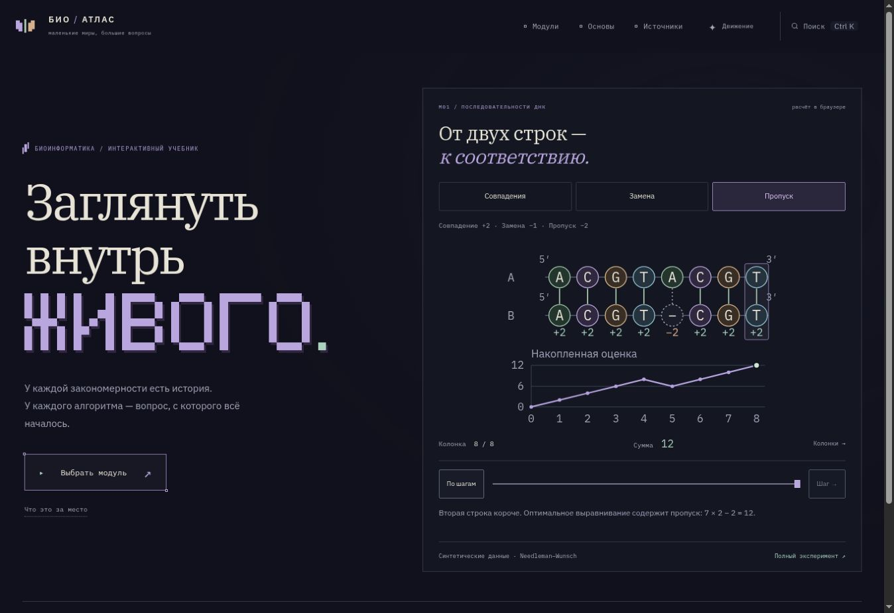

# Научные визуализации

Уточнение пользователя от 27 октября 2026: сохраняется принятая оболочка сайта; сгенерированные арты исключаются. Графика объясняет конкретную задачу, механизм или результат. Biological Modeling подтверждён пользователем как учебный референс.

## Первая реализация

`AlignmentScene` показывает выравнивание двух синтетических последовательностей ДНК и профиль накопленной оценки. Данные получаются из существующей функции Needleman–Wunsch; тот же механизм используется в опубликованной главе M01. Пример не изображает физическую структуру молекулы и не воспроизводит историю реальных мутаций.

- Учебные входы — `src/data/alignment-examples.ts`.
- Вычисление оптимума — `src/algorithms/needleman-wunsch.ts`.
- Вклад колонок и позиции исходных букв — `src/algorithms/alignment-profile.ts`.
- Представление и управление показом — `src/components/AlignmentScene.tsx`.
- Пример на главной интерактивен; M01 в навигаторе получает компактный вычисленный рисунок. У планируемых модулей произвольные графические символы убраны.

Профили проверяются независимо заданными последовательностями сумм: совпадения — 2,4,6,8,10,12,14,16; замена — 2,4,6,8,7,9,11,13; пропуск — 2,4,6,8,6,8,10,12. Дополнительно проверяются позиции букв, пустые строки, отрицательные оценки и разные профили двух равных оптимумов.

## Семантика графики

Обе строки записаны в направлении 5′→3′. Кружки обозначают позиции букв, а не атомы. Штриховая пустая позиция — пропуск в выравнивании. Вклад совпадения +2, замены −1, пропуска −2. По горизонтали графика — номер колонки, по вертикали — накопленная оценка. Связь последовательностей и профиля однозначна.

Анимация показывает уже вычисленный ответ по колонкам. Её шаг не является физическим временем, шагом эволюции или заполнения всей матрицы ДП. Пауза, ручной переход, диапазон и клавиатура управляют только показом; численный результат не меняется.

Происхождение примеров явно подписано: синтетические данные. Подробная постановка, ограничения модели и научные источники находятся в полной главе Needleman–Wunsch.

## Правила следующих визуализаций

1. Сначала определить научный вопрос и наблюдаемую величину, затем выбрать представление.
2. Для графика указать оси, масштаб, единицы, легенду и происхождение данных. Для схемы — смысл объектов и стрелок.
3. Для симуляции задать модель, параметры, начальные условия и воспроизводимость. Не выдавать синтетические данные или модель за измерение.
4. Анимация должна выражать изменение состояния или этап объяснения. У неё есть остановка и смысл шага.
5. Экспериментальные изображения брать из проверенного научного источника с подходящими условиями использования и атрибуцией. Не использовать сгенерированный арт.
6. Вычисления отделять от оформления и проверять независимыми контролями. Ошибка масштаба, цвета или компоновки не должна менять результат.

Изученные страницы референса:

- https://biologicalmodeling.org/prologue/random_walk — траектории частиц и переход от одной частицы к ансамблю.
- https://biologicalmodeling.org/prologue/reaction-diffusion — схема правил, параметры и результаты модели.
- https://biologicalmodeling.org/white_blood_cells/home — связь микроскопических изображений с задачей анализа.

Изображения и видео референса в этот проект не копировались.

## Проверка

- Чистая установка из lock-файла и полный npm run check: 6 групп численных тестов, включая 225 независимых сравнений; типы — 0 ошибок/предупреждений/подсказок; production build и 524 внутренних ссылки/ресурса.
- В браузере все три примера дают 16/13/12. Home на диапазоне возвращает сумму 0; один ручной шаг даёт 2; анимация доходит до 12 и прекращается. Проверено, что после паузы колонка не меняется.
- На 320 px нет глобальной горизонтальной прокрутки; переключение примера даёт 13 и обновляет представление. В навигаторе для планируемых модулей произвольных графиков нет. Компактная иллюстрация M01 скрывается на узких экранах, чтобы не затруднять выбор модулей.
- На главной нет растровых изображений. Сгенерированная иллюстрация и старый снимок с ней удалены из актуальной версии репозитория. Типографика, палитра и порядок модуль → тема → алгоритмы сохранены.
- Визуальная проверка выполнялась на GitHub Pages; локальная служба preview в этой среде недоступна.

